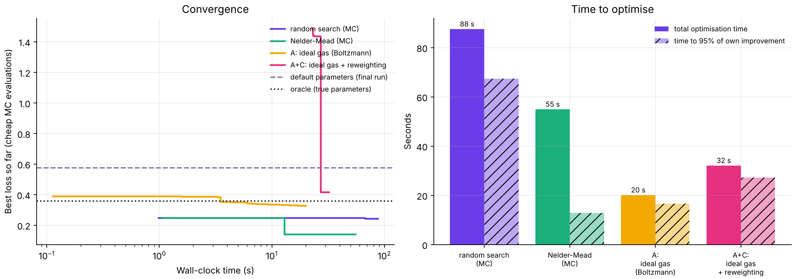
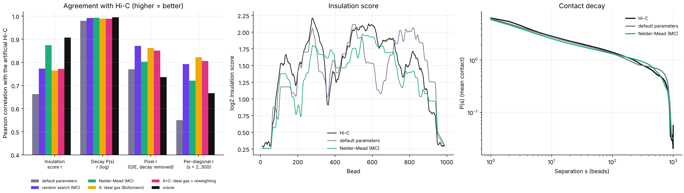
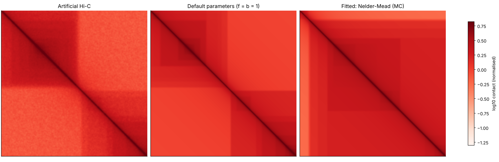

# Optimizer benchmark on a 1000-bead artificial polymer

Run `python demo/optimizer/bench1000.py` (about 6 minutes on 2 cores), then `python demo/optimizer/plots.py`.
Nothing in `src/` is used or modified.

**Data (artificial).** 1000 beads, 110 CTCF sites (random orientation and strength), anchor profiles L and R from forward and reverse sites,
and a Hi-C map made by sampling the loop energy at hidden parameters K=55, f=0.1, b=0.3 (exact Boltzmann sampler, with exclusion of
crossings), adding a distance-decay background and Poisson noise. The optimisers only see an imperfect CTCF annotation (20% of sites missed, 10% spurious).

**Methods.** Default parameters (K = anchors/2, f = b = 1); random search (40 MC runs); Nelder-Mead (60 MC runs); **A** closed-form Boltzmann
density of independent loops (no MC inside the search); **A+C** A followed by 3 cycles of one MC ensemble reweighted over (f, b) with weights exp(-dE/T).
The hard-core DP (B) is left out: it scales as N^3 K^2.

**Scores.** Insulation r: Pearson correlation of the insulation scores (window 10 beads). Decay r: Pearson correlation of log P(s). Pixel r: Pearson of
log(O/E + 0.2) over 2 <= |i-j| <= 300. Diagonal r: mean Pearson over diagonals s = 2..300 between the two maps. Loss = (1 - pixel r) + decay mismatch + (1 - insulation r).

| Method | K | f | b | Insulation r | Decay r | Pixel r (O/E) | Diagonal r | Loss | Optimise time (s) | Time to 95% (s) | Evals |
|---|---|---|---|---|---|---|---|---|---|---|---|
| oracle (true parameters and sites) | 55 | 0.10 | 0.30 | 0.91 | 0.995 | 0.74 | 0.67 | 0.360 | - | - | - |
| default parameters | 50 | 1.00 | 1.00 | 0.66 | 0.980 | 0.77 | 0.55 | 0.575 | - | - | - |
| random search (MC) | 118 | 0.17 | 0.15 | 0.77 | 0.992 | 0.87 | 0.79 | 0.358 | 88 | 67 | 41 |
| Nelder-Mead (MC) | 43 | 0.56 | 0.78 | 0.87 | 0.993 | 0.80 | 0.72 | 0.334 | 55 | 13 | 60 |
| A: ideal gas (Boltzmann) | 120 | 1.00 | 0.22 | 0.77 | 0.989 | 0.86 | 0.82 | 0.394 | 20 | 17 | 171 |
| A+C: ideal gas + reweighting | 120 | 1.00 | 0.20 | 0.77 | 0.989 | 0.85 | 0.81 | 0.400 | 32 | 27 | 39 |

Time to 95% is the time at which the best loss reached 95% of the method's own improvement.
The oracle row is the true parameters with the true sites, one independent MC run; it is the noise ceiling of an MC map, not a bound the fits cannot beat
(fits tuned on the noisy Hi-C can exceed it on pixel correlations).

