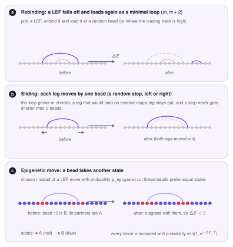

# Monte Carlo

The Monte Carlo stage is the heart of LoopSage. It answers one question: *given the anchors in this region, which sets of loops are likely?* It does not simulate real time. It draws many sets of loops (*snapshots*) at random, in such a way that sets with a low **energy** appear more often than sets with a high energy. The 3D structures are built later from these snapshots.

## The model

The chromatin is a line of $N$ beads. The state of the system is described by:

- $N_{\mathrm{lef}}$ **loop extrusion factors** (LEFs, the cohesin rings). Each one is a loop between two beads, a left leg $m_i$ and a right leg $n_i$ with $m_i<n_i$. Loops may overlap and nest;
- optionally, an **epigenetic state** $S_k\in\{0,1,\dots\}$ for every bead (for example B, neutral, A), used to model compartments.

A state is *probable* when its energy $E$ is low. At temperature $T$ the probability of a state is proportional to $e^{-E/T}$ (the Boltzmann distribution), and the Metropolis rule below produces exactly these probabilities. The temperature $T$ is in arbitrary units; it only says how much *noise* is allowed: a high $T$ accepts many unfavourable moves, a low $T$ almost none.

## The energy

The total energy is a sum of terms, each with one coefficient that you can change:

$$
E = E_{\mathrm{fold}} + E_{\mathrm{bind}} + E_{\mathrm{cross}} \;(+\,E_{\mathrm{tracks}}) \;(+\,E_{\mathrm{epi}}).
$$

The first three terms are always present; the extra tracks and the epigenetic term are optional and zero unless switched on.

We go through them one by one. In all formulas the sum over $i$ runs over the LEFs.

### Folding: long loops are good

$$
E_{\mathrm{fold}} = f\,c_f\sum_i \ln(n_i-m_i),\qquad c_f=-\frac{N}{N_{\mathrm{lef}}\,\ln(N/N_{\mathrm{lef}})} .
$$

The constant $c_f$ is *negative*, so a longer loop has a *lower* energy: extruders want to grow. The logarithm makes the gain smaller and smaller for very long loops, so that nothing grows without bound, and the normalisation $c_f$ makes the coefficient $f$ (`folding_coeff`, default 1) comparable for different numbers of beads and extruders. A second family of extruders (`n_lef2`, for example a different kind of ring) has its own coefficient $f_2$ (`folding_coeff2`).

### Binding: legs like anchors

$$
E_{\mathrm{bind}} = b\,c_b\sum_i \big(L_{m_i}+R_{n_i}\big),\qquad c_b=-\frac{2N}{N_{\mathrm{anchors}}},
$$

where $L$ and $R$ are the anchor profiles from [Preprocessing](preprocessing.md) and $N_{\mathrm{anchors}}$ is the number of anchors in the input. Again $c_b<0$: a left leg on a bead with a high $L$ and a right leg on a bead with a high $R$ lower the energy. The coefficient $b$ is `bind_coeff`. Which profile is used (preferential or contrastive) is decided in the preprocessing, see [Preferential and contrastive binding](preprocessing.md#preferential-and-contrastive-binding). In the 2D mode (`data_loss_mode = 1`) the term uses the loop map, $E_{\mathrm{bind}}=b\,c_b\sum_i J^{\mathrm{loss}}_{m_i n_i}$, and scores the *pair* of legs.

**Contrastive mode.** With `binding_mode = contrastive` the binding term gets a second part that looks at the beads *inside* each loop:

$$
E_{\mathrm{bind}} = b\,c_b\sum_i\Big[\big(L_{m_i}+R_{n_i}\big)+\frac{1}{\bar\ell}\sum_{k=m_i}^{n_i-1}\hat c_k\Big],
$$

where $\hat c_k\in[-1,1]$ is the coverage score of bead $k$ (−1 only where the input has no loops, 0 where it has some, up to +1 where it has many) (see [Preprocessing](preprocessing.md#preferential-and-contrastive-binding)) and $\bar\ell$ is the mean input loop length, which keeps the second part on the scale of one anchor. Since $c_b<0$, a loop is rewarded for spanning beads with $\hat c>0$ and penalised for spanning loop-free beads ($\hat c=-1$). The inner sum is a difference of prefix sums, $P_{n_i}-P_{m_i}$ with $P_j=\sum_{k<j}\hat c_k$, so a move costs $O(1)$. In preferential mode only the first part is used.

### Crossing: loops should not cross

$$
E_{\mathrm{cross}} = \kappa\,10^{4}\sum_{i<j}K_{ij}, \qquad
K_{ij}=\begin{cases}1 & \text{if loops } i,j \text{ interleave } (m_i<m_j<n_i<n_j)\\ 1 & \text{if they share a leg position}\\ 0 & \text{otherwise.}\end{cases}
$$

Two loops that cross, or that sit on the same bead, would be hard to build in 3D without the polymer passing through itself. The huge constant $10^4$ makes this penalty act almost as a *rule*: the sampler practically never keeps such a state. Nested loops (one inside the other) and neighbouring loops are free. The coefficient is $\kappa$ (`cross_coeff`).

```ini
cross_loop               = True    # penalise interleaved loops, not only shared legs
between_families_penalty = True    # count crossings between the two LEF families too
```

### Extra tracks

Each BigWig track $t$ adds a term $r_t\sum_i (B^t_{m_i}+B^t_{n_i})/\sum_k B^t_k$, where $B^t$ is the track and $r_t$ its strength (`bw_strengths`). It works like the binding term, with a signal that is not a loop anchor.

### Epigenetic states (the Potts term)

When `epi_coeff` $=\varepsilon>0$, every bead carries a state and the energy gets

$$
E_{\mathrm{epi}} = -\varepsilon\Big[\sum_{i<j}J_{ij}\,\delta(S_i,S_j)\;+\;\sum_k h_k\,S_k\Big].
$$

This is a *Potts model*. The first sum rewards pairs of beads that are linked ($J_{ij}=1$) *and* in the same state ($\delta=1$ when $S_i=S_j$, otherwise 0). The links are the chain neighbours and the **current loops**, so beads that a loop brings together tend to share the same state, and compartments grow from loops. The second sum is an external *field*: $h_k$ comes from the compartment track (see [Compartments from Hi-C](preprocessing.md#compartments-from-hi-c)), so A beads ($h>0$) are pulled to the high states and B beads ($h<0$) to the low ones. With $\varepsilon=0$ the term is off, which is the default and gives the pure loop-extrusion model.

```ini
epi_coeff       = 0.0        # 0 = off; > 0 turns on the epigenetic states
n_epi_states    = 3          # number of states (B, neutral, A)
epigenetic_mode = dynamic    # J follows the current loops (dynamic) or is fixed from the input (static)
p_epigenetic    = 0.5        # share of the steps that change a state instead of moving a LEF
```

## The moves

One **Monte Carlo step** consists of $2N_{\mathrm{lef}}$ attempted moves, so on average every LEF is touched twice. Each attempt does the following:

1. With probability `p_epigenetic` (only if the epigenetic model is on) it changes the state of one random bead. Otherwise it picks one LEF at random and tries one of two moves with equal chance:
2. **Rebinding.** The LEF is removed and loaded again somewhere else as the smallest possible loop, $(m,m+2)$. The place is a random bead, or, if you give a loading track, chosen in proportion to that track.
3. **Sliding.** The two legs move by one bead each, independently and in a random direction (a random walk), so the loop can grow or shrink. A leg that would land on another loop's leg stays where it was, and a loop is never shorter than two beads. With `lef_rw = False` the legs only move outward, which is pure extrusion.

<figure markdown>
  { width="780" }
  <figcaption markdown="span">The three moves. <b>a</b> A LEF unbinds and loads again as a minimal loop. <b>b</b> The legs slide. <b>c</b> One bead changes its epigenetic state (red = A, blue = B); with the dynamic coupling the beads linked by the chain and by loops count.</figcaption>
</figure>

### Accept or reject

For every move the change of energy $\Delta E$ is computed (only the terms that involve the moved LEF or bead are recomputed, so the cost does not grow with the number of loops). The move is then accepted with the **Metropolis probability**

$$
p_{\mathrm{accept}}=\min\!\big(1,\;e^{-\Delta E/T}\big).
$$

A move that lowers the energy is always accepted. A move that raises it is accepted with a probability that falls with $\Delta E$ and rises with $T$. This is what lets the system escape from a bad arrangement while still preferring good ones.

### Temperature: Metropolis or annealing

With `method = Metropolis` the temperature is constant, $T=T_{\mathrm{init}}$. With `method = Annealing` (default) the temperature falls linearly from $T_{\mathrm{init}}$ to $T_{\mathrm{final}}$ over the run, so the system first explores freely and then settles. Because snapshots are saved all the time, early snapshots are hotter, and the first part is removed by the burn-in.

### LEF speeds

Sliding picks the LEF uniformly by default, so all LEFs are equally fast. With `lef_speed_dist` the LEFs get different *speeds* and the faster ones are chosen more often for sliding. The mean speed is always 1.

| `lef_speed_dist` | Speeds |
|---|---|
| `constant` | all equal |
| `maxwell` | Maxwell&ndash;Boltzmann: the speed of a particle with a Gaussian velocity in 3D |
| `lognormal` | $\ln v$ is Gaussian with width `lef_speed_spread` |
| `two_state` | a fraction `lef_fast_fraction` of fast LEFs, `lef_fast_ratio` times faster than the others |

## Snapshots and statistics

The stage runs `n_steps` steps and saves the loops of all LEFs (and all states) every `mc_step` steps. The first `burnin` steps are *burn-in*: the system is still forgetting its random start (and, with annealing, is hot), so these snapshots are kept but not used for statistics. The snapshots after the burn-in are the **production** ensemble, and with `replicas` > 1 several independent chains are run in parallel and pooled. For every snapshot the stage also records the energy terms (total, binding, crossing, folding) and the *unfolded fraction*, the share of the chain not covered by any loop.

!!! tip "Checking convergence"
    The report shows the energy terms after the burn-in with a *drift*: the difference between the two halves of the production run in units of the standard deviation. A drift well below 1 means that the energy is stable; a large drift means that the run is too short (raise `n_steps`) or the burn-in too small.

## The arguments

All options of this stage, grouped:

```ini
[monte_carlo]
n_steps    = 20000       # total Monte Carlo steps                       (CLI: --mc-steps)
mc_step    = 200         # one snapshot every this many steps            (CLI: --sample-every)
burnin     = 1000        # steps whose snapshots are not used            (CLI: --burnin)
method     = Annealing   # Metropolis or Annealing                       (CLI: --method)
t_init     = 3.0         # starting temperature (a.u.)                   (CLI: --t-init)
t_final    = 1.0         # final temperature, Annealing only             (CLI: --t-final)
n_lef      =             # extruders (empty: number of anchors / 2)      (CLI: --n-lef)
n_lef2     = 0           # a second family of extruders
lef_rw     = True        # legs slide as a random walk                   (CLI: --lef-rw)
lef_speed_dist = constant   # constant, maxwell, lognormal, two_state    (CLI: --lef-speed)
variable_sliding_step = False   # step uniform in [1, shortest input loop] beads
replicas   = 1           # independent chains, pooled                    (CLI: --n-replicas)

[energy]
folding_coeff  = 1.0     # f:     reward for long loops
bind_coeff     = 1.0     # b:     reward for legs on anchors
cross_coeff    = 1.0     # kappa: penalty for crossing loops
epi_coeff      = 0.0     # epsilon: epigenetic coupling, 0 = off
```

!!! note "Which ones to tune"
    The numbers that decide the look of the result are $N_{\mathrm{lef}}$, $f$, $b$ and the temperature. The [optimizer](optimizer.md) fits exactly these four to a target. The crossing coefficient $\kappa$ is better left at 1: it is a constraint more than a preference. The number of steps only needs to be large enough for the energy to be stable.

## Where the code is

| File | Role |
|---|---|
| `src/loopsage/monte_carlo/energy.py` | every energy term and its change $\Delta E$ for one move |
| `src/loopsage/monte_carlo/sampler.py` | parameters of the sampler, the two LEF moves, the Metropolis loop (compiled with numba) |
| `src/loopsage/monte_carlo/simulation.py` | runs the chains, collects the snapshots, the result object and its saving |
| `src/loopsage/pipeline/stage_mc.py` | the pipeline stage: runs the simulation, writes the tables and figures |

### Outputs

The snapshots are saved in `data/mc.npz`. The report shows the energy along the run, the acceptance rate of each move, the loops over the region (see the figure of simulated and input loops), and the contact map implied by the loops. The 3D stage reads the snapshots from this file.
