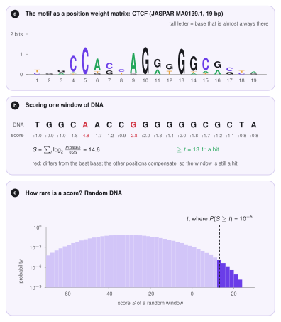
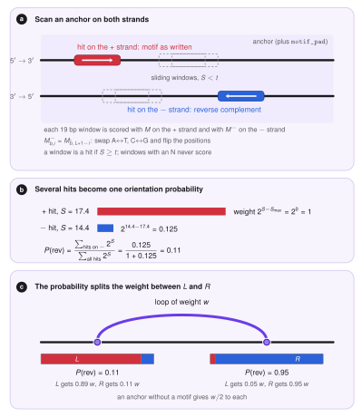

# The Motif Finder

The direction of a CTCF site decides which legs of a ring it can stop (see [Loop extrusion](../theory/loop-extrusion.md)): a *forward* site stops a leg that moves left, a *reverse* site stops a leg that moves right.
Loop files such as ChIA-PET or HiChIP tell us *where* the two anchors of a loop are, but not in which direction the CTCF sites point.
The **motif finder** reads this direction from the DNA sequence. It searches each anchor of a loop for the CTCF motif on both strands, turns the hits into a probability that the site is reversed, and writes this probability into the loop file. The Monte Carlo stage then uses it to build the profiles $L$ and $R$.

It is an optional step: it runs when a reference genome is given (`--motif-genome`), and the plain BEDPE import keeps working without it.

## The mathematics

The idea is simple: slide a window along the DNA, give every window a *score* that says how much it looks like a CTCF site, and keep the windows that score high. The rest of this section explains how the score is built, how high it must be, and how the hits become one number per anchor. A tiny made-up motif of length $L=3$ is used as a running example, so every formula can be checked by hand.

### From known sites to a score

*Notation.* DNA is a string of four bases $b\in\{A,C,G,T\}$. A *motif* of length $L$ is a short pattern that a protein recognises; positions are numbered $i=1,\dots,L$. A window $x=x_1x_2\dots x_L$ is a piece of DNA of the same length.

*Counts.* We start from a collection of $N$ DNA sites that are known to be bound by the protein. At every position we count how many times each base occurs: $c_{b,i}$ is the number of sites with base $b$ at position $i$. This table is the *position frequency matrix* (PFM). In the toy example, with $N=10$ sites:

| | $i=1$ | $i=2$ | $i=3$ |
|---|---|---|---|
| A | 8 | 0 | 0 |
| C | 0 | 10 | 1 |
| G | 1 | 0 | 9 |
| T | 1 | 0 | 0 |

Position 1 is mostly A, position 2 is always C and position 3 is mostly G, so the motif is roughly `ACG`. For CTCF the table has $L=19$ columns (JASPAR MA0139.1).

*Probabilities.* The fraction $c_{b,i}/N$ would be a natural probability of base $b$ at position $i$. But a base that was never seen (for example G at position 2) would get probability $0$, and then any window with a G there would be rejected for ever, however well it matches elsewhere. To avoid this we add a small *pseudocount* $\alpha$ (`motif_pseudocount`, default $0.8$), shared equally among the four bases,

$$
p_{b,i}=\frac{c_{b,i}+\alpha/4}{N+\alpha}.
$$

Check: the four numbers at one position still add up to 1, because the $\alpha/4$ terms add to $\alpha$. In the toy example, $p_{A,1}=(8+0.2)/10.8=0.76$ and $p_{G,2}=0.2/10.8=0.019$: unlikely, but not impossible.

*Log-odds.* To decide whether a window is *motif-like* we compare two stories: the window was drawn from the motif, or it is random DNA, in which every base has probability $1/4$ at every position. At one position the ratio of the two probabilities is $p_{b,i}/(1/4)$. Windows have $L$ independent positions, so the ratios multiply. Products of many numbers are awkward, so we take the logarithm (base 2), which turns the product into a sum. The *position weight matrix* (PWM) is

$$
M_{b,i}=\log_2\frac{p_{b,i}}{1/4},
$$

and the *score* of a window is

$$
S(x)=\sum_{i=1}^{L}M_{x_i,\,i}=\log_2\prod_{i=1}^{L}\frac{p_{x_i,i}}{1/4}.
$$

The right-hand form says what $S$ means: $2^{S}$ is how many times more likely the window is under the motif than under random DNA. Each point of score is a doubling. A base that is more common than $1/4$ adds a positive number, a base that is rarer subtracts, and a base seen at the motif's favourite level adds close to the maximum.

In the toy example the matrix is

| | $i=1$ | $i=2$ | $i=3$ |
|---|---|---|---|
| A | $+1.60$ | $-3.75$ | $-3.75$ |
| C | $-3.75$ | $+1.92$ | $-1.17$ |
| G | $-1.17$ | $-3.75$ | $+1.77$ |
| T | $-1.17$ | $-3.75$ | $-3.75$ |

so the consensus window `ACG` scores $1.60+1.92+1.77=5.29$ (it is $2^{5.29}\approx 39$ times more likely under the motif than at random), the window `TCG` scores $-1.17+1.92+1.77=2.52$, and `ACT` scores $1.60+1.92-3.75=-0.23$. The best possible score is the consensus; for CTCF it is $26.1$ (`TGGCCACCAGGGGGCGCTA`). Because every position contributes only a little, a window with one or two mismatches can still score high (panel b below).

### How high must a score be?

A window is a *hit* when $S\ge t$. The cutoff $t$ must be strict enough that random DNA rarely passes, and we say how rare with a *p-value* $\pi$ (`motif_pvalue`, default $10^{-5}$): $t$ is the smallest score for which

$$
P_0(S\ge t)\le\pi ,
$$

where $P_0$ is the probability for a window of random DNA with independent, equally likely bases. In words: random DNA passes only about once in $1/\pi$ windows. A smaller $\pi$ means a higher $t$ and fewer, more reliable hits.

In the toy example there are $4^3=64$ possible windows, all equally likely at random. Only `ACG` scores above $5$, so $P_0(S\ge5)=1/64$. For CTCF there are $4^{19}\approx 2.7\times10^{11}$ windows, far too many to list, so the distribution of the score is built *position by position* instead. Let $f_i(s)$ be the probability that the first $i$ positions of a random window add up to $s$. We start with $f_0(0)=1$ (an empty window has score $0$). Adding position $i$, each of the four bases appears with probability $1/4$ and shifts the sum by $M_{b,i}$:

$$
f_i(s)=\frac14\sum_{b\in\{A,C,G,T\}} f_{i-1}\big(s-M_{b,i}\big).
$$

In the toy example, after position 1 the possible sums are $1.60,\,-3.75,\,-1.17,\,-1.17$, each with probability $1/4$ (so $-1.17$ has $1/2$); position 2 shifts every sum again, and so on. After the last position, the tail is added up:

$$
P_0(S\ge t)=\sum_{s\ge t}f_L(s).
$$

This is *exact* (no simulation) and needs only $L$ steps. To keep the number of distinct sums finite, scores are rounded to $1/100$. For the bundled CTCF matrix this gives $t=8.3$ for $\pi=10^{-4}$, $t=13.1$ for $\pi=10^{-5}$ and $t=17.0$ for $\pi=10^{-6}$ (panel c below).

<figure markdown>
  { width="640" }
  <figcaption><b>a</b> The CTCF motif (JASPAR MA0139.1) as a logo: the height of a letter is how strongly that base is preferred at that position. <b>b</b> One window of DNA is scored by adding one number per position. <b>c</b> The score of a window of random DNA has a known distribution, which fixes the cutoff <i>t</i>.</figcaption>
</figure>

### Two strands

DNA has two strands that run in opposite directions, and a protein can bind a site on either of them. A site on the *reverse* strand reads, along the written strand, as the *reverse complement* of the motif: every base is swapped for its partner ($A\leftrightarrow T$, $C\leftrightarrow G$) and the order is reversed. For the toy motif `ACG` it is `CGT`. Scoring the reverse-strand site therefore uses the matrix

$$
M^{-}_{b,i}=M_{\bar b,\;L+1-i},
$$

where $\bar b$ is the partner of $b$ and $L+1-i$ is the mirrored position. Every window is scored twice: with $M$ (strand $+$, the motif as written, a *forward* site) and with $M^{-}$ (strand $-$, a *reverse* site). A window that contains an unknown base (N) never gives a hit.

Testing both strands doubles the number of tests, so the chance of a false hit grows. An anchor of $n$ bp has $2(n-L+1)$ windows, and random DNA gives at least one false hit with probability

$$
1-(1-\pi)^{2(n-L+1)} .
$$

The report compares the fraction of anchors with a hit with this number: real CTCF anchors should be much richer in motifs than random DNA.

### One probability per anchor

An anchor can contain several hits, on both strands, and they may disagree. We want one number: how likely is the site to be *reversed*? Say the hits $h$ have scores $S_h$ and strands $\sigma_h\in\{+,-\}$. Since $2^{S_h}$ is a likelihood ratio, it measures how strong the evidence is that hit $h$ is the true site. We define

$$
P(\mathrm{rev})=\frac{\sum_{h:\,\sigma_h=-}2^{S_h}}{\sum_{h}2^{S_h}},
$$

the *share of the evidence that sits on reverse hits*. It is between $0$ (all evidence forward) and $1$ (all reverse), and a hit that is 3 points stronger counts $2^3=8$ times more. In the code the weights are written $2^{S_h-S_{\max}}$, which gives the same ratio (the common factor $2^{-S_{\max}}$ cancels) but avoids huge numbers. An anchor without any hit gets $P(\mathrm{rev})=-1$, meaning *unknown*.

For example, a $+$ hit with $S=17.4$ and a $-$ hit with $S=14.4$ have weights $1$ and $2^{-3}=0.125$, so $P(\mathrm{rev})=0.125/1.125=0.11$: the site is most probably forward.

### From orientation to $L$ and $R$

The model describes each CTCF site by two *profiles* along the chromosome: $L_k$ says how strongly bead $k$ stops legs that move left (forward sites) and $R_k$ how strongly it stops legs that move right (reverse sites). Each loop carries a weight $w$ (its PET count, i.e. the number of read pairs supporting it, or 1 when the file has none). Its two anchors are placed on beads, and the weight of the anchor on bead $k$ is shared between the profiles according to its probability $P_k$,

$$
L_k \mathrel{+}= w\,(1-P_k),\qquad R_k \mathrel{+}= w\,P_k .
$$

A sure forward site ($P_k=0$) feeds only $L$, a sure reverse site only $R$, and an anchor with unknown orientation gives $w/2$ to each. A loop whose left anchor is forward and whose right anchor is reverse is *convergent*, and its two legs can both stop there.

<figure markdown>
  { width="640" }
  <figcaption><b>a</b> Each window of an anchor is scored on both strands. <b>b</b> The hits of an anchor are combined into one probability of being reversed. <b>c</b> This probability divides the weight of the loop between <i>L</i> (red) and <i>R</i> (blue).</figcaption>
</figure>

## The algorithm

For every loop file the finder does the following steps, in this order.

1. **Read and filter.** The BEDPE is read (at least six columns; the seventh is the PET count or score). Loops with both anchors inside the modelled region and with at least `min_pet` counts are kept, and identical loops are counted once.
2. **Collect anchors.** The distinct anchors $(\text{chrom},\text{start},\text{end})$ of the kept loops are listed, so an anchor shared by many loops is scanned only once.
3. **Read the sequence.** Each anchor, extended by `motif_pad` bp on both sides, is read from the reference genome. The FASTA file is indexed (a `.fai` file is created next to it and reused), so only the requested piece is read, never the whole genome.
4. **Scan.** The windows of the anchor are scored on both strands, and every window with $S\ge t$ is a hit. The scan adds the $L$ shifted columns of the matrix, so it needs about $L$ operations per base.
5. **Call.** The number of hits, the best score, its strand and position and $P(\mathrm{rev})$ are computed for the anchor.
6. **Write.** The probabilities of the two anchors are written as columns 8 and 9 of an annotated BEDPE, and the model reads them as its $L$ and $R$ profiles.

## Using the motif finder

!!! note "In LoopSage"
    The search runs in the preparation stage when a genome is given. Example: `examples/02_chiapet_motif_orientation.ini`.

```bash
loopsage -c config.ini --motif-genome hg38.fa
loopsage -c config.ini --motif-genome hg38.fa --motif-pvalue 1e-4 --min-pet 3
```

| Key (option) | Default | Meaning |
|---|---|---|
| `motif_genome` (`--motif-genome`) | none | reference genome FASTA (not compressed); turns the motif search on |
| `motif_pfm` (`--motif-pfm`) | bundled CTCF MA0139.1 | motif counts, four rows A, C, G, T of equal length, or a JASPAR file |
| `motif_pvalue` (`--motif-pvalue`) | $10^{-5}$ | chance of a hit in random DNA: smaller is stricter |
| `motif_pseudocount` | 0.8 | pseudocount $\alpha$ added to the counts |
| `motif_pad` | 0 | bp added on both sides of every anchor before the search |
| `min_pet` (`--min-pet`) | 0 | keep only loops with at least this many PET counts or this score |

Chromosome names are matched flexibly (`1` and `chr1` are the same). A BEDPE that already has orientation probabilities in columns 8 and 9 keeps them when no genome is given, and they are replaced when it is.

### Where the code is

| File | Role |
|---|---|
| `src/motif_finder/pssm.py` | the matrix $M$, the exact cutoff, the two-strand scan |
| `src/motif_finder/fasta.py` | indexed random access to a reference genome |
| `src/motif_finder/annotate.py` | filtering, scanning anchors, $P(\mathrm{rev})$, the annotated BEDPE |
| `src/preproc/readers.py` | turns the probabilities into the profiles $L$ and $R$ |

### Outputs

The data folder gets the annotated loop file `loops_annotated.bedpe` (the six BEDPE columns, the PET count and the two probabilities, with $-1$ for unknown), and the tables `motif_loops.tsv` (one row per loop) and `motif_anchors.tsv` (one row per anchor: number of hits, best score, strand, position and $P(\mathrm{rev})$), and `motif_stats.json` with the counts of every step.
The report shows the motif, its cutoff, the fraction of anchors with a motif next to what random DNA would give, and how many loops have both, one or no oriented anchor, plus a figure with the number of loops after each step, the best score of every anchor against the cutoff, and the orientation of the left against the right anchor (convergent loops lie in one corner).

!!! tip "Reading the result"
    Most loops from CTCF experiments should have convergent anchors. If the share of anchors with a motif is close to the random value, the cutoff is probably too loose, or the anchors are not CTCF-driven, and the orientations are then not informative.

## References

- Staden R. (1984). Computer methods to locate signals in nucleic acid sequences. *Nucleic Acids Research* 12, 505.
- Touzet H., Varré J.-S. (2007). Efficient and accurate P-value computation for position weight matrices. *Algorithms for Molecular Biology* 2, 15.
- Castro-Mondragon J. A. et al. (2022). JASPAR 2022: the 9th release of the open-access database of transcription factor binding profiles. *Nucleic Acids Research* 50, D165.
- Rao S. S. P. et al. (2014). A 3D map of the human genome at kilobase resolution reveals principles of chromatin looping. *Cell* 159, 1665.
- de Wit E. et al. (2015). CTCF binding polarity determines chromatin looping. *Molecular Cell* 60, 676.
