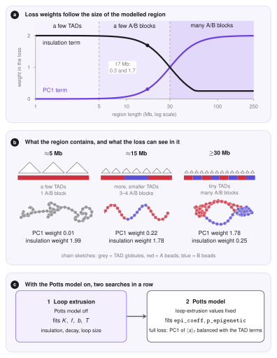

# The Optimizer

LoopSage has a few numbers that nobody can measure directly: how many extruders $N_{\mathrm{lef}}$ are on the region, how strong the folding and the binding terms are, and how noisy the simulation is (its temperature).
The *optimizer* is an optional stage (`--optimize`) that finds good values of these numbers automatically.
It tries many short simulations and keeps the parameters whose simulated contact map looks most like a *target map*, which is either a Hi-C map or the map drawn from the input loops.

<figure markdown>
  { width="780" }
  <figcaption markdown="span">The optimizer. A short Monte Carlo run turns a parameter set <i>θ</i> into a loop map, the loss compares it with the target, and Nelder&ndash;Mead proposes the next <i>θ</i>. When the search stops, the best candidates are re-scored on longer runs and the winner is used for the production run.</figcaption>
</figure>

## Overview

1. A parameter set $\theta=(K,f,b,T)$ is chosen.
2. A short Monte Carlo run with $\theta$ produces loops, which are drawn as a contact map.
3. The loss compares this map with the target map (compartments, decay, domains, loop size).
4. Nelder&ndash;Mead proposes a better $\theta$, and steps 2 to 4 repeat until the search stops.
5. The best few candidates are re-scored on longer runs, and the winner is used for the production run.


## Quick start

!!! note "In LoopSage"
    The optimizer needs a target: a BEDPE loop file, or a Hi-C map (`--hic`). Run it with `--optimize`. The Monte Carlo stage then runs all its steps with the optimized values.

```bash
loopsage -c config.ini --optimize
loopsage -c config.ini --optimize --opt-evals 40 --opt-steps 20000 --hic sample.hic
```

!!! tip "Prefer a Hi-C target"
    A dense map such as Hi-C (`--hic`) constrains the decay, the domains and the compartments together, so the fitted values are reliable. Sparse loop data (ChIA-PET, HiChIP) hold only a few hundred dots and say little about loop length and folding; the search then tends towards small $f$ and short loops, which is an effect of sparsity, not of the chromatin.

    With loop data alone, the insulation and decay profiles are taken from the loops themselves, not from the dot map: each loop counts on all beads between its anchors (its *coverage*, used as the insulation profile) and at all separations up to its length (the decay), for input and simulated loops alike. The profiles are smoothed over about 100 kb, so boundaries are less sharp. Check that $f$ and the loop sizes are plausible.

## What is fitted

The optimizer searches for four numbers, collected in the vector $\theta=(K,\ f,\ b,\ T)$:

- $K$: the number of extruders $N_{\mathrm{lef}}$ of the first family,
- $f$: the strength of the *folding* term of the energy (it depends on the loop sizes),
- $b$: the strength of the *binding* term (it rewards legs that sit on CTCF sites),
- $T$: a *temperature scale* that multiplies the whole schedule (`t_init` and `t_final`), so an annealing schedule keeps its shape.

The search runs on $x=(K,\ln f,\ln b,\ln T)$, because $f$, $b$ and $T$ act multiplicatively: doubling $f$ matters equally at $f=0.1$ and at $f=1$. Every parameter stays in a box: $f\in[0.05,3]$, $b\in[0.25,3]$, $T\in[1,3]$, and $K$ between about a quarter and four times its start value $K_0$ (never above $N_{\mathrm{beads}}/3$). The start is $\theta_0=(K_0,f_0,b_0,1)$, with $f_0,b_0$ from the configuration.

## The target and the simulated map

Both are $N\times N$ contact maps $M_{ij}$ between beads. The *simulated* map is built from the loops $(m,n)$ of a short Monte Carlo run: each loop gives a dot at $(m,n)$, a weaker enrichment inside it, and *communication* between loops that share an anchor (up to 6 loops in a chain, each step weaker by 0.6). The *target* map is either the denoised Hi-C map (`--hic`) or the input loops drawn in exactly the same way and smoothed over `target_smooth` beads. Each map is divided by the mean of its upper triangle, so only shape matters.

Two quantities are used below. The *decay* $P(s)$ is the mean of the $s$-th diagonal of the map, i.e. the mean contact at separation $s$. The *observed/expected map* is $\tilde M_{ij}=M_{ij}/P(|i-j|)$: the decay is divided out, so only domains and loops remain.

## The loss

The loss measures how far the simulated map is from the target. It is $0$ for a perfect match and is a weighted sum of four terms,

$$
L(\theta)=w_{\mathrm{eig}}\,L_{\mathrm{eig}}+0.5\,L_{P}+w_{\mathrm{ins}}\,L_{\mathrm{ins}}+L_{\mathrm{size}} .
$$

We do not correlate the two heatmaps entry by entry. Instead we compare a few numbers that summarise a map, its *components*: the compartment pattern, the decay with distance, the domain boundaries and the loop size. Each term is a distance between $0$ (identical) and about $1$ (completely different).

| Term | What it compares | Biological meaning | Weight |
|---|---|---|---|
| $L_{\mathrm{eig}}$ | leading eigenvectors (PC1, ...) of the two maps | A/B compartments | $w_{\mathrm{eig}}$, grows with the region |
| $L_{P}$ | shape of the decay $P(s)$ | how contacts fall with distance, i.e. loop length and folding | $0.5$ |
| $L_{\mathrm{ins}}$ | insulation profiles | TAD boundaries | $w_{\mathrm{ins}}$, falls with the region |
| $L_{\mathrm{size}}$ | mean loop length | loops must not collapse | $1$ |

### Compartments (eigenvector term)

Take the correlation matrix of $\ln(\tilde M+0.2)$, where $\tilde M$ is the observed/expected map (each diagonal divided by its mean, so the decay drops out). Its *eigenvectors* are the directions along which the map varies most, and the first one is the familiar PC1 that separates compartments. Let $u^{\mathrm{sim}}_j$ and $u^{\mathrm{tgt}}_j$ be the first $k=3$ eigenvectors of the two maps, paired by the size of their eigenvalues. The sign of an eigenvector is arbitrary, so we take *absolute values* $|u|$ (entry by entry) and set

$$
L_{\mathrm{eig}}=1-\frac1k\sum_{j=1}^{k}\frac{|u^{\mathrm{sim}}_j|\cdot|u^{\mathrm{tgt}}_j|}{\big\||u^{\mathrm{sim}}_j|\big\|\,\big\||u^{\mathrm{tgt}}_j|\big\|} .
$$

The fraction is the *cosine* of the angle between two vectors, between $0$ and $1$ here because all entries are non-negative. So $L_{\mathrm{eig}}$ is $0$ for the same profiles along the chromosome and $1$ for profiles with no overlap.

!!! note "With the Potts model on"
    When `epi_coeff` > 0 the compartments live in the *average state* $\langle s\rangle_t$ of every bead (its Potts state averaged over the production snapshots and smoothed with a sliding window along the chain), not in the eigenvectors of the simulated map. Then $L_{\mathrm{eig}}$ compares $\langle s\rangle_t$ with the A/B reference, which is the leading eigenvector of the Hi-C map when there is one (otherwise the compartment track), with the sign set so that B is negative:

    $$
    L_{\mathrm{eig}}=\frac{1-r}{2},\qquad r=\operatorname{corr}\big(\langle s\rangle_t,\ \mathrm{PC1}^{\mathrm{ref}}\big).
    $$

    The Pearson correlation $r$ lies in $[-1,1]$, so the term runs from $0$ (same A/B pattern) to $1$ (mirror image). Without a reference the eigenvector comparison above is used.

### Decay with distance

$$
L_P=\operatorname{Var}_s\big[\ln P^{\mathrm{sim}}(s)-\ln P^{\mathrm{tgt}}(s)\big],
$$

with a small offset $0.02$ inside the logarithms. The variance is $0$ when the two decays differ only by a constant factor, so $L_P$ compares the *shape* of the decay, not its scale.

### Domain boundaries (insulation term)

The *insulation* $I_i$ of bead $i$ is the mean contact in the diamond across it, with a half-width of 100 kb (at least 5 beads), so it is low at a boundary. Each profile is rescaled to $[0,1]$, $\hat I_i=(I_i-\min I)/(\max I-\min I)$, and

$$
L_{\mathrm{ins}}=\operatorname{mean}_i\big|\hat I^{\mathrm{sim}}_i-\hat I^{\mathrm{tgt}}_i\big| ,
$$

a distance between $0$ (same profile) and $1$ (opposite). For a target made of loops (BEDPE) the insulation and the decay are not read from the drawn map but from the loops themselves; see [the note on Hi-C targets](#quick-start).

### Loop size

$$
L_{\mathrm{size}}=\max\!\Big(0,\ \Big|\log_2\frac{\tilde\ell^{\mathrm{sim}}}{\tilde\ell^{\mathrm{input}}}\Big|-1\Big),
$$

with $\tilde\ell$ the *median* loop length. The term is zero while the simulated median is within a factor 2 of the input median, and grows by one for every further factor 2, in either direction. Sparse loop data hardly constrain the loop size, and without it the search can drift to tiny loops, or, with the folding coefficient at its upper limit and the binding weak, to loops stacked over the whole region. The median is used instead of the mean because input loop lengths have a long tail: the mean would ask for far more nesting than the extruders can supply.

### Weights follow the region size

The two weights $w_{\mathrm{eig}}$ and $w_{\mathrm{ins}}$ depend on the *length of the modelled region* $S$, because the two terms describe structures of different size. TADs are domains of about 0.1–1 Mb, so in a region of a few Mb the insulation is the informative term. Compartments are blocks of a few Mb: a 5 Mb region holds at most one or two of them, so PC1 says almost nothing there. It starts to carry information when the region contains 2–3 blocks (about 10 Mb) and dominates when it contains many (30 Mb up to a whole chromosome). The switch is sharp, not linear:

$$
s=\frac{1}{1+(S_0/S)^{3}},\qquad w_{\mathrm{eig}}=2s,\qquad w_{\mathrm{ins}}=\max\big(2(1-s),\,0.25\big),\qquad S_0=30\,\mathrm{Mb}.
$$

Here $s$ is a smooth switch from $0$ (small regions) to $1$ (large ones), and $S_0$ is where both weights equal $1$.

| Region | $w_{\mathrm{eig}}$ | $w_{\mathrm{ins}}$ | What dominates |
|---|---|---|---|
| 5 Mb | 0.01 | 2.0 | TADs and loops |
| 10 Mb | 0.07 | 1.9 | TADs and loops |
| 17 Mb | 0.3 | 1.7 | mostly TADs and loops |
| 30 Mb | 1.0 | 1.0 | balanced |
| 60 Mb | 1.8 | 0.25 | compartments |
| 100 Mb or more | 2.0 | 0.25 | compartments |

The weights used are printed in the log and shown in the report.

<figure markdown>
  { width="700" }
  <figcaption markdown="span"><b>a</b> The weight of the PC1 (eigenvector) term and of the insulation term against the length of the modelled region. <b>b</b> What a region of that size contains: TADs (triangles), A (red) and B (blue) compartment blocks, and a sketch of the chain. A small region holds a few TADs and at most one A/B block, so PC1 carries almost no information; a large region holds many blocks, which segregate in space into an A and a B cloud. <b>c</b> With the Potts model on, the loop-extrusion parameters are fitted first and the Potts parameters second.</figcaption>
</figure>

## The search: Nelder&ndash;Mead

Every evaluation of $L$ is a Monte Carlo run. So $L$ has no formula and no gradient, one input ($K$) is an integer, and the value is *noisy*: two seeds give slightly different losses. A method that only needs *values* of $L$ fits well, and the optimizer uses the *Nelder&ndash;Mead simplex method* (Nelder and Mead, 1965; the SciPy implementation follows Gao and Han, 2012).

**The idea.** In $n=4$ dimensions a *simplex* is a set of $n+1=5$ points $x_{(1)},\dots,x_{(5)}$, like a triangle in 2D. Imagine that the points are hikers on a foggy hill who can only measure their own height $L$. The one who stands highest (the worst point) walks to a better place, using what the others know. Repeating this makes the group slide downhill and shrink around a minimum.

**Initial simplex.** It contains the start $x_0$ and four more points, each obtained by moving *one* coordinate of $x_0$: $K$ by $+\max(0.3K_0,2)$, $\ln f$ by $-1.2$, $\ln b$ by $-1.2$ and $\ln T$ by $+0.5$.

**One iteration.** Sort the points so that $L(x_{(1)})\le\dots\le L(x_{(5)})$. Write $x_w=x_{(5)}$ for the worst point and $c=\tfrac14\sum_{i=1}^{4}x_{(i)}$ for the centre of the other four. Then:

1. *Reflect.* Mirror the worst point through the centre, $x_r=c+(c-x_w)$, and evaluate $L(x_r)$.
2. *Expand.* If $L(x_r)<L(x_{(1)})$ (better than all points), the direction is very good, so go twice as far: $x_e=c+2\,(x_r-c)$. Keep the better of $x_e$ and $x_r$ in place of $x_w$.
3. *Accept.* If $L(x_{(1)})\le L(x_r)<L(x_{(4)})$ (neither best nor worst), keep $x_r$ in place of $x_w$.
4. *Contract.* If $L(x_r)\ge L(x_{(4)})$ the step was too bold, so step back towards the centre: $x_c=c+\tfrac12(x_r-c)$ if $L(x_r)<L(x_w)$ (*outside* contraction), and $x_c=c+\tfrac12(x_w-c)$ otherwise (*inside* contraction). If $L(x_c)$ is better than the point it was compared with ($x_r$ or $x_w$ respectively), keep $x_c$ in place of $x_w$.
5. *Shrink.* If the contraction did not help either, the simplex is probably around a valley floor, so every point moves halfway to the best one: $x_{(i)}\leftarrow x_{(1)}+\tfrac12\big(x_{(i)}-x_{(1)}\big)$ for $i=2,\dots,5$.

The factors $1$, $2$, $\tfrac12$ and $\tfrac12$ are the standard choices (reflection, expansion, contraction, shrink). In LoopSage, $K$ is rounded to an integer and every point is clipped to the box before it is evaluated.

## One evaluation

An evaluation is a *short run* of `opt_steps` steps (the first quarter is burn-in, one replica, 200 snapshots, so about 150 equilibrium configurations) with a *new* random seed, never that of the production run. One step is a sweep over all LEFs, so the cost of an evaluation grows with the number of LEFs and the loss maps with the square of the number of beads.

**Large regions.** For a big region(above `opt_max_beads`, 1500 beads by default; 20 000 or 50 000 beads are common) the optimizer therefore simulates only the window of that many beads that holds most loops, with the LEF density kept, and the fitted number of LEFs is scaled back to the whole region. The production run then uses your own `n_steps` and sampling frequency.

## When the search stops

The search stops at the first of three events:

- *Converged:* the simplex is smaller than $0.02$ in $x$ and the losses of its points differ by less than $0.005$.
- *Budget:* `opt_evals` evaluations have been used.
- *Early stopping* (on by default): the best loss dropped by less than `opt_min_gain` (0.01) over the last `opt_patience` (20) evaluations. Because the loss is noisy, tiny gains do not count as progress, and the search is not wasted on noise.

## The final check

The lowest loss of a noisy search is often a lucky one (the *winner's curse*). So the best three distinct candidates and the starting point are re-scored with runs *three times longer* and new seeds, and the lowest long-run loss wins. The result is therefore never worse than the start on the long check; if the start wins, it is kept and the report says that the optimizer "gave up".

## With the Potts model: two stages

When the Potts model is on and there is an A/B reference, the optimizer runs two searches in a row, so that the compartments do not disturb the fit of the loops:

1. **Loop extrusion.** It fits $K$, $f$, $b$ and the temperature scale with the Potts model *off*, using only the insulation, the decay and the loop size ($w_{\mathrm{eig}}=0$).
2. **Potts model.** It keeps those values and fits `epi_coeff` (searched within a factor 10 around its start) and `p_epigenetic` (between 0.1 and 0.9) with the *full* weighted loss. The field $h$ of the Potts model already carries the A/B pattern (from the compartment track or from the Hi-C eigenvector), so the correlation with the reference is easy to reach. What the search really decides is the balance: the coupling is increased only as far as it helps the compartments *and* does not harm the TAD terms. Because PC1 enters with the region-size weight, it hardly matters in a small region, where the coupling is then set mainly by not damaging the insulation.

Stage 2 uses a third of the evaluations of stage 1 (at least 10). Without an A/B reference, `epi_coeff` is not optimized and a warning is printed.

## Settings

| Key (option) | Default | Meaning |
|---|---|---|
| `optimize` (`--optimize`) | off | fit $K$, $f$, $b$ and the temperature before the run |
| `opt_evals` (`--opt-evals`) | 60 | maximum number of short Monte Carlo evaluations |
| `opt_steps` (`--opt-steps`) | 4000 | Monte Carlo steps of one evaluation (the final check runs 3x longer) |
| `opt_max_beads` (`--opt-max-beads`) | 1500 | largest region the optimizer simulates; a bigger one is optimized on a window of this many beads |
| `opt_early_stop` (`--opt-early-stop`) | on | stop when the loss no longer improves |
| `opt_interactive` (`--opt-interactive`) | on | pressing Enter during the search shows the best parameters so far and asks whether to keep them and stop, (Y/n), Enter = yes (terminal only) |
| `opt_patience` (`--opt-patience`) | 20 | early stopping: evaluations without a real improvement before stopping |
| `opt_min_gain` | 0.01 | early stopping: smallest drop of the best loss that counts as an improvement |
| `target_smooth` (`--target-smooth`) | 0.8 | smoothing of the loop-based target, in beads |
| `hic_denoise` (`--hic-denoise`) | 1.0 | denoising of the Hi-C target, in beads |
| `track_smooth` (`--track-smooth`) | 7.0 | smoothing of the Hi-C insulation score and eigenvector (A/B track), in beads; raw Hi-C profiles are noisy, which makes the loss rough and slows convergence |
| `hic_file` (`--hic`), `hic_norm`, `hic_resolution` | | the Hi-C target and how it is read |

The total cost is about $\texttt{opt\_steps}\times(\texttt{opt\_evals}+12)$ Monte Carlo steps: the evaluations of the search, plus four final checks of three times the length. Early stopping usually makes it shorter.

## Where the code is

| File | Role |
|---|---|
| `src/optimizer/objective.py` | the loss: target map, loss terms and weights, one evaluation of $L(\theta)$ |
| `src/optimizer/nelder_mead.py` | the search: bounds, Nelder&ndash;Mead, early stopping, final check |
| `src/pipeline/stage_optimize.py` | the pipeline stage: reads the target, runs the search, writes the result and the report |

## Outputs

The stage writes the chosen values into `config_resolved.ini`, marked with the source `optimizer`, and saves `optimized_parameters.json` (start and best parameters, loss terms, number of evaluations, whether the search converged). The report contains the table of the parameters before and after, the four loss terms, the best evaluations, and three figures: the convergence of the loss, the landscape explored by the search, and the target map next to the simulated one. A one-sentence verdict says whether the search converged, stopped early or used up its budget, and warns if a parameter sits at the edge of its range, because then the optimum may lie outside.

!!! tip "Reading the result"
    A loss of 0 is a perfect match, and the loss at the start is typically between 1 and 4. If the *start* wins the final check, the starting parameters were already as good as the search could find. If $K$, $f$, $b$ or $T$ sits at the edge of its range, the box is probably too tight for your data.

## References

- Nelder J. A., Mead R. (1965). A simplex method for function minimization. *The Computer Journal* 7, 308.
- Gao F., Han L. (2012). Implementing the Nelder-Mead simplex algorithm with adaptive parameters. *Computational Optimization and Applications* 51, 259.
