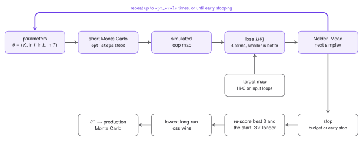

# The Optimizer

LoopSage has a few numbers that nobody can measure directly: how many extruders $N_{\mathrm{lef}}$ are on the region, how strong the folding and the binding terms are, and how noisy the simulation is (its temperature).
The *optimizer* is an optional stage (`--optimize`) that finds good values of these numbers automatically.
It tries many short simulations and keeps the parameters whose simulated contact map looks most like a *target map*, which is either a Hi-C map or the map drawn from the input loops.

<figure markdown>
  { width="780" }
  <figcaption>The optimizer. A short Monte Carlo run turns a parameter set <i>θ</i> into a loop map, the loss compares it with the target, and Nelder&ndash;Mead proposes the next <i>θ</i>. When the search stops, the best candidates are re-scored on longer runs and the winner is used for the production run.</figcaption>
</figure>

## The mathematics

### What is fitted

The optimizer searches for four numbers, collected in the vector $\theta=(K,\ f,\ b,\ T)$:

- $K$: the number of extruders $N_{\mathrm{lef}}$ of the first family,
- $f$: the strength of the *folding* term of the energy (it depends on the loop sizes),
- $b$: the strength of the *binding* term (it rewards legs that sit on CTCF sites),
- $T$: a *temperature scale* that multiplies the whole schedule (`t_init` and `t_final`), so an annealing schedule keeps its shape.

The search runs on $x=(K,\ln f,\ln b,\ln T)$, because $f$, $b$ and $T$ act multiplicatively: doubling $f$ matters equally at $f=0.1$ and at $f=1$. Every parameter stays in a box: $f\in[0.05,3]$, $b\in[0.25,3]$, $T\in[1,3]$, and $K$ between about a quarter and four times its start value $K_0$ (never above $N_{\mathrm{beads}}/3$). The start is $\theta_0=(K_0,f_0,b_0,1)$, with $f_0,b_0$ from the configuration.

### The target and the simulated map

Both are $N\times N$ contact maps $M_{ij}$ between beads. The *simulated* map is built from the loops $(m,n)$ of a short Monte Carlo run: each loop gives a dot at $(m,n)$, a weaker enrichment inside it, and *communication* between loops that share an anchor (up to 6 loops in a chain, each step weaker by 0.6). The *target* map is either the denoised Hi-C map (`--hic`) or the input loops drawn in exactly the same way and smoothed over `target_smooth` beads. Each map is divided by the mean of its upper triangle, so only shape matters.

Two quantities are used below. The *decay* $P(s)$ is the mean of the $s$-th diagonal of the map, i.e. the mean contact at separation $s$. The *observed/expected map* is $\tilde M_{ij}=M_{ij}/P(|i-j|)$: the decay is divided out, so only domains and loops remain.

### The loss

The loss measures how far the simulated map is from the target and is $0$ for a perfect match,

$$
L(\theta)=w_{\mathrm{eig}}\,L_{\mathrm{eig}}+0.5\,L_{P}+w_{\mathrm{ins}}\,L_{\mathrm{ins}}+L_{\mathrm{size}} .
$$

We do not correlate the two heatmaps entry by entry. Instead we compare their *components*, the few numbers that summarise a map: its leading eigenvectors, its decay, its insulation and the loop size.

- $L_{\mathrm{eig}}$ compares the *pattern*. Take the correlation matrix of $\ln(\tilde M+0.2)$, where $\tilde M$ is the observed/expected map. Its *eigenvectors* are the directions along which the map varies most; the first one is the familiar PC1 that separates compartments. Let $u^{\mathrm{sim}}_1,\dots,u^{\mathrm{sim}}_k$ and $u^{\mathrm{tgt}}_1,\dots,u^{\mathrm{tgt}}_k$ be the first $k=3$ eigenvectors of the two maps, paired by the size of their eigenvalues. The sign of an eigenvector is arbitrary, so we take *absolute values* $|u|$ (entry by entry), which are non-negative, and set
$$
L_{\mathrm{eig}}=1-\frac1k\sum_{j=1}^{k}\frac{|u^{\mathrm{sim}}_j|\cdot|u^{\mathrm{tgt}}_j|}{\big\||u^{\mathrm{sim}}_j|\big\|\,\big\||u^{\mathrm{tgt}}_j|\big\|} .
$$
The fraction is the *cosine* of the angle between two vectors, a number between $0$ and $1$ here because all entries are non-negative. So $L_{\mathrm{eig}}$ lies between $0$ (the same profiles along the chromosome) and $1$ (profiles with no overlap).
- $L_P=\operatorname{Var}_s\big[\ln P^{\mathrm{sim}}(s)-\ln P^{\mathrm{tgt}}(s)\big]$ (with a small offset $0.02$ inside the logarithms). It is $0$ when the decays differ only by a constant factor, so it compares the *shape* of the decay.
- $L_{\mathrm{ins}}$ compares the *domain boundaries*. The insulation $I_i$ of bead $i$ is the mean contact in the $5\times5$ square across it, so $I_i$ is low at a boundary. Each profile is first rescaled to $[0,1]$ ($\hat I_i=(I_i-\min I)/(\max I-\min I)$), and then $L_{\mathrm{ins}}=\operatorname{mean}_i|\hat I^{\mathrm{sim}}_i-\hat I^{\mathrm{tgt}}_i|$, a distance between $0$ (same profile) and $1$ (opposite).
- $L_{\mathrm{size}}=\max\!\big(0,\log_2\frac{\bar\ell^{\mathrm{input}}}{\bar\ell^{\mathrm{sim}}}\big)$, with $\bar\ell$ the *mean* loop length. It stops the search from drifting to tiny loops when the data are sparse, and never pushes loops to be longer than the input.

*With the Potts model on* (`epi_coeff` > 0) the compartments live in the *average state* $\langle s\rangle_t$ of every bead (its Potts state averaged over the production snapshots and smoothed with a sliding window along the chain), not in the eigenvectors of the simulated map. Then $L_{\mathrm{eig}}$ compares $\langle s\rangle_t$ with the A/B reference, the leading eigenvector of the Hi-C map when there is one (otherwise the compartment track), with the sign set so that B is negative:
$$
L_{\mathrm{eig}}=\frac{1-r}{2},\qquad r=\operatorname{corr}\big(\langle s\rangle_t,\ \mathrm{PC1}^{\mathrm{ref}}\big).
$$
The Pearson correlation $r$ lies in $[-1,1]$, so the term runs from $0$ (same A/B pattern) to $1$ (mirror image). Without a reference, or with the Potts model off, the eigenvector comparison above is used.

The weights $w_{\mathrm{eig}}$ and $w_{\mathrm{ins}}$ depend on the *size of the region*, because the two terms describe structures of different size. TADs are domains of a few hundred kb, so in a short region the insulation is the informative term and the eigenvectors, which describe the large-scale (compartment) pattern, say little. In a region of tens of Mb the compartments are what the map shows. With $S$ the length of the modelled region in bp, let
$$
x=\operatorname{clip}\!\Big(\frac{\ln(S/1\,\mathrm{Mb})}{\ln(20)},\,0,\,1\Big),\qquad w_{\mathrm{eig}}=0.5\cdot4^{x},\qquad w_{\mathrm{ins}}=2\cdot4^{-x}.
$$
So $x=0$ (a region of 1 Mb or less) gives $(w_{\mathrm{eig}},w_{\mathrm{ins}})=(0.5,2)$, insulation dominant; $x=1$ (20 Mb or more) gives $(2,0.5)$, eigenvectors dominant; and $x=\tfrac12$ (about 4.5 Mb) gives $(1,1)$, a balance. The decay weight stays $0.5$ and the size weight $1$. The weights used are shown in the report and in the log.

### The search: Nelder&ndash;Mead

Every evaluation of $L$ is a Monte Carlo run. So $L$ has no formula and no gradient, one input ($K$) is an integer, and the value is *noisy*: two seeds give slightly different losses. A method that only needs *values* of $L$ fits well, and the optimizer uses the *Nelder&ndash;Mead simplex method* (Nelder and Mead, 1965; the SciPy implementation follows Gao and Han, 2012).

*The idea.* In $n=4$ dimensions a *simplex* is a set of $n+1=5$ points $x_{(1)},\dots,x_{(5)}$, like a triangle in 2D. Imagine that the points are hikers on a foggy hill who can only measure their own height $L$. The one who stands highest (the worst point) walks to a better place, using what the others know. Repeating this makes the group slide downhill and shrink around a minimum.

*Initial simplex.* It contains the start $x_0$ and four more points, each obtained by moving *one* coordinate of $x_0$: $K$ by $+\max(0.3K_0,2)$, $\ln f$ by $-1.2$, $\ln b$ by $-1.2$ and $\ln T$ by $+0.5$.

*One iteration.* Sort the points so that $L(x_{(1)})\le\dots\le L(x_{(5)})$. Write $x_w=x_{(5)}$ for the worst point and $c=\tfrac14\sum_{i=1}^{4}x_{(i)}$ for the centre of the other four. Then:

1. *Reflect.* Mirror the worst point through the centre, $x_r=c+(c-x_w)$, and evaluate $L(x_r)$.
2. *Expand.* If $L(x_r)<L(x_{(1)})$ (better than all points), the direction is very good, so go twice as far: $x_e=c+2\,(x_r-c)$. Keep the better of $x_e$ and $x_r$ in place of $x_w$.
3. *Accept.* If $L(x_{(1)})\le L(x_r)<L(x_{(4)})$ (neither best nor worst), keep $x_r$ in place of $x_w$.
4. *Contract.* If $L(x_r)\ge L(x_{(4)})$ the step was too bold, so step back towards the centre: $x_c=c+\tfrac12(x_r-c)$ if $L(x_r)<L(x_w)$ (*outside* contraction), and $x_c=c+\tfrac12(x_w-c)$ otherwise (*inside* contraction). If $L(x_c)$ is better than the point it was compared with ($x_r$ or $x_w$ respectively), keep $x_c$ in place of $x_w$.
5. *Shrink.* If the contraction did not help either, the simplex is probably around a valley floor, so every point moves halfway to the best one: $x_{(i)}\leftarrow x_{(1)}+\tfrac12\big(x_{(i)}-x_{(1)}\big)$ for $i=2,\dots,5$.

The factors $1$, $2$, $\tfrac12$ and $\tfrac12$ are the standard choices (reflection, expansion, contraction, shrink). In LoopSage, $K$ is rounded to an integer and every point is clipped to the box before it is evaluated.

Each evaluation is a *short run* of `opt_steps` steps (the first quarter is burn-in, one replica) with a *new* random seed, never that of the production run.

### When the search stops

The search stops at the first of three events:

- *Converged:* the simplex is smaller than $0.02$ in $x$ and the losses of its points differ by less than $0.005$.
- *Budget:* `opt_evals` evaluations have been used.
- *Early stopping* (on by default): the best loss dropped by less than `opt_min_gain` (0.01) over the last `opt_patience` (20) evaluations. Because the loss is noisy, tiny gains do not count as progress, and the search is not wasted on noise.

### The final check

The lowest loss of a noisy search is often a lucky one (the *winner's curse*). So the best three distinct candidates and the starting point are re-scored with runs *three times longer* and new seeds, and the lowest long-run loss wins. The result is therefore never worse than the start on the long check; if the start wins, it is kept and the report says that the optimizer "gave up".

## Using the optimizer

!!! note "In LoopSage"
    The optimizer needs a target: a BEDPE loop file, or a Hi-C map (`--hic`). Run it with `--optimize`. The Monte Carlo stage then runs all its steps with the optimized values.

!!! tip "Prefer a Hi-C target"
    Give the optimizer a `.hic` file (`--hic`), ideally a smooth experiment such as Hi-C, as the target. Sparse loop data (ChIA-PET, HiChIP) contain only a few hundred dots, so the map they draw says little about how long loops should be or how strongly the chain should fold. The search then tends to settle on small values of $f$ and on short loops. This is unrealistic, and it is a side effect of sparsity, not a property of the chromatin. A dense map constrains the decay, the domains and the compartments together, so the fitted values are more reliable. With loop data alone, the target's insulation and decay profiles are smoothed more strongly (over about the insulation window, 100 kb), so that longer loops are not punished; the price is less sharp boundaries. Read the result with care and check that $f$ and the loop sizes are plausible.

```bash
loopsage -c config.ini --optimize
loopsage -c config.ini --optimize --opt-evals 40 --opt-steps 20000 --hic sample.hic
```

| Key (option) | Default | Meaning |
|---|---|---|
| `optimize` (`--optimize`) | off | fit $K$, $f$, $b$ and the temperature before the run |
| `opt_evals` (`--opt-evals`) | 60 | maximum number of short Monte Carlo evaluations |
| `opt_steps` (`--opt-steps`) | 20000 | Monte Carlo steps of one evaluation (the final check runs 3x longer) |
| `opt_early_stop` (`--opt-early-stop`) | on | stop when the loss no longer improves |
| `opt_patience` (`--opt-patience`) | 20 | early stopping: evaluations without a real improvement before stopping |
| `opt_min_gain` | 0.01 | early stopping: smallest drop of the best loss that counts as an improvement |
| `target_smooth` (`--target-smooth`) | 0.8 | smoothing of the loop-based target, in beads |
| `hic_denoise` (`--hic-denoise`) | 1.0 | denoising of the Hi-C target, in beads |
| `hic_file` (`--hic`), `hic_norm`, `hic_resolution` | | the Hi-C target and how it is read |

The total cost is about $\texttt{opt\_steps}\times(\texttt{opt\_evals}+12)$ Monte Carlo steps: the evaluations of the search, plus four final checks of three times the length. Early stopping usually makes it shorter.

### Where the code is

| File | Role |
|---|---|
| `src/optimizer/objective.py` | the loss: target map, loss terms and weights, one evaluation of $L(\theta)$ |
| `src/optimizer/nelder_mead.py` | the search: bounds, Nelder&ndash;Mead, early stopping, final check |
| `src/pipeline/stage_optimize.py` | the pipeline stage: reads the target, runs the search, writes the result and the report |

### Outputs

The stage writes the chosen values into `config_resolved.ini`, marked with the source `optimizer`, and saves `optimized_parameters.json` (start and best parameters, loss terms, number of evaluations, whether the search converged). The report contains the table of the parameters before and after, the four loss terms, the best evaluations, and three figures: the convergence of the loss, the landscape explored by the search, and the target map next to the simulated one. A one-sentence verdict says whether the search converged, stopped early or used up its budget, and warns if a parameter sits at the edge of its range, because then the optimum may lie outside.

!!! tip "Reading the result"
    A loss of 0 is a perfect match, and the loss at the start is typically between 1 and 4. If the *start* wins the final check, the starting parameters were already as good as the search could find. If $K$, $f$, $b$ or $T$ sits at the edge of its range, the box is probably too tight for your data.

## References

- Nelder J. A., Mead R. (1965). A simplex method for function minimization. *The Computer Journal* 7, 308.
- Gao F., Han L. (2012). Implementing the Nelder-Mead simplex algorithm with adaptive parameters. *Computational Optimization and Applications* 51, 259.
