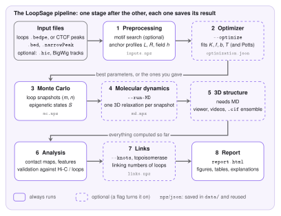

# The Pipeline

LoopSage turns a list of loops into three-dimensional structures in a few steps. It first *reads* the data, then *samples* many possible sets of loops with a Monte Carlo simulation, then *relaxes* every set into a 3D polymer with molecular dynamics, and finally *compares* the result with experiments.
Each of these steps is a **stage**. This page shows how the stages follow one another, what each of them hands to the next one, and how to run all of them or just one.

<figure markdown>
  { width="780" }
  <figcaption markdown="span">The pipeline. Solid boxes always run, dashed boxes run when a flag asks for them. Every stage that produces data saves it in the run folder, so a later run can start from it.</figcaption>
</figure>

## The stages

**1. Preprocessing.** The stage reads the loop file (BEDPE) or the CTCF peaks (BED, narrowPeak) for the chosen region and puts everything on a grid of *beads*, the simulation units (a bead is a piece of chromatin of a few kb). If you asked for it, it first runs the [Motif Finder](motif-finder.md) to find the direction of the CTCF sites. The result is a set of arrays: the anchor profiles $L$ and $R$ (how strongly each bead holds a left or right leg of an extruder), the loop map, optional tracks, and an optional compartment field $h$. If a Hi-C file is given, it is read here too. See [Preprocessing](preprocessing.md).

**2. Optimizer** (`--optimize`). A few numbers of the model cannot be measured: the number of extruders, the strength of the folding and the binding, the temperature. The optimizer tries many short simulations and keeps the values whose loops look most like the target (a Hi-C map or the input loops). It passes the chosen values to the next stage. See [The Optimizer](optimizer.md).

**3. Monte Carlo.** The core of the model. A set of $N_{\mathrm{lef}}$ extruders, each one a loop between two beads, is moved at random and the moves are accepted or rejected with an energy rule. One Monte Carlo step is a *sweep* of $N_{\mathrm{sweep}}$ proposals (`n_sweep`): in each proposal a random extruder is chosen and a rebinding or sliding move is tried. By default $N_{\mathrm{sweep}} = 2N_{\mathrm{lef}}$, so a step proposes about two changes per extruder; a larger value makes each step longer and the snapshots more independent. The stage saves a *snapshot* of all loops every few steps. See [Monte Carlo](monte-carlo.md).

**4. Molecular dynamics** (`--run-MD`). Every Monte Carlo snapshot is turned into a 3D structure: the loops become springs in a bead-spring polymer, which is relaxed with a Langevin simulation in OpenMM. See [Molecular Dynamics](molecular-dynamics.md).

**5. 3D structure.** It works on the MD frames: interactive viewer, videos, and the ensemble of structures as `.cif` files. It only runs together with the MD.

**6. Analysis.** Contact maps are built from the Monte Carlo loops and from the 3D frames, and compared with the input loops and with Hi-C when it is given (correlations, insulation, decay with distance). It also extracts map features such as TAD boundaries.

**7. Links** (`--knots`, or a topoisomerase mode). An optional topological analysis of the 3D loops (linking numbers), described in [Topology](../theory/topology.md).

**8. Report.** Everything above is collected in one `report.html` with the figures, tables and short explanations.

## What is passed from stage to stage

The stages do not talk to each other directly. They share one *run context* that holds the results computed so far, and each stage reads what it needs from it:

| Stage | Reads | Produces |
|---|---|---|
| Preprocessing | the input files | $L$, $R$, loop map, tracks, field $h$, the Hi-C map |
| Optimizer | the inputs and the target | the best $N_{\mathrm{lef}}$, $f$, $b$ and temperature (written into the configuration) |
| Monte Carlo | the inputs and the configuration | for every snapshot: the loop positions $(m_i,n_i)$, the epigenetic states, the energy terms |
| Molecular dynamics | the snapshots | for every snapshot: the 3D coordinates of all beads |
| Analysis | all of the above | maps, scores, validation figures |

The Monte Carlo snapshots are the bridge between the model and the 3D structure: the molecular dynamics never sees the energy of the Monte Carlo, only the final loops and states.

## Running it

A run is described by a configuration file, by command-line options, or by both (an option overrides the file). Every option has a configuration key, see the [Reference](../reference/index.md).

```bash
# everything, from a config file
loopsage -c config.ini

# the same with options only
loopsage -f loops.bedpe -r chr1:78000000-92000000 -n 1000 -t 4 --run-MD -o results

# add the optimizer and a Hi-C file
loopsage -f loops.bedpe -r chr1:78000000-92000000 -n 1000 --run-MD --optimize --hic sample.hic
```

You can also run **one stage** on its own. The earlier stages are then not recomputed: their saved results are loaded from the latest run folder.

```bash
python -m loopsage.pipeline.stage_mc -c config.ini      # only the Monte Carlo, inputs are reused
python -m loopsage.pipeline.stage_md -c config.ini      # only the MD, the Monte Carlo is reused
```

Because the Monte Carlo result is saved, you can change only MD options (time step, forces, number of steps per frame) and repeat the MD without sampling the loops again.

## The run folder

Every run writes its files into its own folder, named after the region and a run number:

```text
results/chr1_78000000_92000000_1/
  config_resolved.ini     every option used, and where its value came from
  data/                   saved stage results (inputs.npz, mc.npz, md.npz, ...)
    metadata/             maps and matrices as .npy
  structures/             init_structure.cif, trajectory.dcd, ensemble/ (one .cif per frame)
  visualizations/         all figures (png and svg), the 3D viewer, videos
  report/report.html      the report
  logs/loopsage.log       the full log
```

The file `config_resolved.ini` is the best record of a run: it contains every option, and for each one whether it was a default, came from the file, from the command line, or was set by the optimizer. With the same file and the same `--seed` (and `--threads 1` for the MD) a run can be repeated exactly.

## Where the code is

| File | Role |
|---|---|
| `src/loopsage/api.py` | entry points: the `loopsage` command (`cli`) and the Python functions |
| `src/loopsage/pipeline/runner.py` | the run context and the loop over the stages (compute, or load the saved result, then describe) |
| `src/loopsage/pipeline/stage_*.py` | one file per stage; each has `enabled`, `compute`, `load` and `describe` |
| `src/loopsage/knots/stage.py` | the optional links stage |
| `src/loopsage/settings/` | the list of options (`schema.py`), reading of files and command line, checks |
