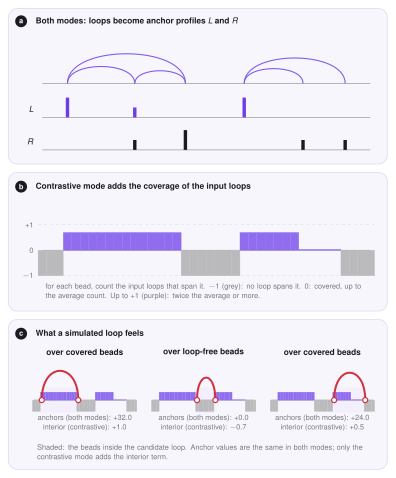

# Preprocessing

The simulation does not work with genomic coordinates, files and read counts. It works with *beads* and with a few arrays of numbers per bead. The preprocessing stage is the translation: it reads the experimental files for your region and turns them into the arrays that the [Monte Carlo](monte-carlo.md) needs.
This page explains what is read, how every file type is modelled, and the two ways to turn anchor signal into an energy landscape (*preferential* and *contrastive* binding).

## What comes out

| Array | Meaning | Used by |
|---|---|---|
| $L_k$, $R_k$ | how strongly bead $k$ holds the *left* leg and the *right* leg of an extruder (anchor profiles) | binding energy |
| $J_{ij}$ | which bead pairs are connected: the chain backbone and the input loops | epigenetic coupling (static mode) |
| $J^{\mathrm{loss}}_{ij}$ | weighted map of the input loops | binding energy in the 2D mode |
| $h_k$ | compartment field, $+1$ for A and $-1$ for B | epigenetic energy, compartment force |
| extra tracks | BigWig signals, a loading preference for extruders | extra binding energy, loading |
| Hi-C map | contact map on the bead grid | validation, target of the optimizer, field $h$ |

## Region and beads

You choose a chromosome region and the number of beads $N$. The region is cut into $N$ equal pieces, and bead $k$ stands for the $k$-th piece. The *bead size* is the region length divided by $N$ (for 14 Mb and 1000 beads: 14 kb). If you give no number of beads, LoopSage uses one bead per 2 kb.

```ini
[input]
chrom        = chr1
region_start = 78000000
region_end   = 92000000
n_beads      = 1000          # empty: region length / 2 kb
genome       = hg38          # or hg19: only used for chromosome sizes
```

On the command line the region is `-r chr1:78000000-92000000` and the beads `-n 1000`. A loop anchor is placed on the bead that contains the *middle* of the anchor interval; two anchors that fall on the same bead make a loop of length zero, so they are dropped.

## Loop files (BEDPE)

A BEDPE file has one line per loop, with the two anchors as genomic intervals:

```text
chr1  78450000  78460000  chr1  78790000  78800000  14
#     start1    end1      #     start2    end2      score (weight)
```

The first six columns are the two anchors, the seventh (optional) is the *weight* of the loop, normally the number of read pairs (PET count) that support it. A loop with weight 14 pulls the model's attention more than a loop with weight 2. Two more optional columns (the eighth and ninth) hold the probability that each anchor's CTCF site is *reversed*; they are written by the [Motif Finder](motif-finder.md) and are the only place where the direction of the CTCF sites enters.

### From loops to $L$ and $R$

Every loop adds its weight to the two beads of its anchors. If the directions of the CTCF sites are known, the weight of an anchor is divided between $L$ (forward site) and $R$ (reverse site), exactly as described in [From orientation to $L$ and $R$](motif-finder.md#from-orientation-to-l-and-r). Without directions, each anchor feeds both profiles and the model decides the orientation on its own. At the end of this step $L_k$ and $R_k$ are large on beads where many loops start (or end) and zero elsewhere.

Three further steps make the profiles easy to use:

1. **Smoothing.** A ChIA-PET anchor is a window of a few kb, but the simulation can place a leg only on a bead; a very sharp spike would either be hit exactly or missed. A Gaussian filter spreads each spike over a few neighbouring beads, with width $\sigma=\max(1.5,\,N/300)$ beads (about 40 kb for 1000 beads over 14 Mb). It is on by default (`smoothing_input = True`).
2. **Mean scaling.** Each profile is divided by its mean over the beads, so the average bead has value 1. After this, the numbers do not depend on how many loops the file has or on the bead size.
3. **Binding mode** (next section): optionally add the coverage of the input loops, so that loop-free beads are penalised.

### The loop maps

Besides $L$ and $R$ the stage keeps two $N\times N$ matrices. $J$ is binary: 1 on the chain backbone (neighbouring beads) and on every input loop. $J^{\mathrm{loss}}$ keeps the weights of the loops. By default the energy uses only $L$ and $R$ (`data_loss_mode = 0`); with `data_loss_mode = 1` it uses $J^{\mathrm{loss}}$ instead, which scores a *pair* of legs and not each leg alone. In that mode $J^{\mathrm{loss}}$ is smoothed with a Gaussian of width `loss_sigma` beads, so that the extruder legs see a continuous landscape and not isolated dots.

## Peak files (BED, narrowPeak)

If you have only CTCF ChIP-seq peaks and no loops, give a `.bed` or `.narrowPeak` file. Each peak is a binding site with a weight (the score column); a peak spanning several beads spreads its weight over them. There are no loop pairs in such a file, so only $L$ and $R$ are built (the 2D mode and the loop-based optimizer target are not available). An optional probability column gives the direction of each site in the same way as for BEDPE.

## Preferential and contrastive binding

The profiles $L$ and $R$ enter the energy through the *binding energy*: a leg placed on a bead with a large value lowers the energy, so it is more probable (the Monte Carlo page gives the formula). What the energy should say about beads *without* any anchor is a modelling choice, and LoopSage offers two:

```ini
[energy]
binding_mode = preferential      # or: contrastive          (CLI: --binding-mode)
```

<figure markdown>
  { width="780" }
  <figcaption markdown="span"><b>a</b> Every loop adds its weight to the bead of its left anchor ($L$) and of its right anchor ($R$); this is the same in both modes. <b>b</b> Contrastive mode also measures how much the input loops cover each bead. <b>c</b> What a simulated loop feels at three places. Numbers are from this toy example.</figcaption>
</figure>

**Preferential binding** (default). Only the anchors count: a leg is *attracted* to the anchors and feels nothing special elsewhere, so a loop-free region costs nothing. Its weakness is that, with few and strong anchors, the extruders can form loops over regions where the input has none.

**Contrastive binding.** The anchor terms are the same, and a second term is added that looks at the *inside* of a loop. For every bead we count how many input loops span it (its *coverage*) and rescale it,

$$
\hat c_k=\begin{cases}-1 & c_k<0.05\,\bar c\quad\text{(loop free)},\\[2pt] \mathrm{clip}\!\left(\dfrac{c_k}{\bar c}-1,\,0,\,1\right) & \text{otherwise,}\end{cases}
$$

where $c_k$ is the coverage of bead $k$ and $\bar c$ its mean. So $\hat c_k=-1$ only on a bead that (practically) no input loop spans, $0$ on every covered bead up to the average coverage, and up to $+1$ at twice the average or more. A simulated loop is penalised only for beads inside it that are really loop free, and rewarded for beads that are covered more than average: beads with few but some loops cost nothing. It enters the binding energy, see [Monte Carlo](monte-carlo.md#binding-legs-like-anchors).

!!! note "What the coverage term adds"
    Every extruder has one left and one right leg, so the anchor terms depend only on the *shape* of $L$ and $R$ (a constant shift would change every state equally and cancel in the Metropolis rule). The coverage term looks at the beads *between* the two legs, and that number differs from one loop to another, so it changes the preferred loops. It needs loops (a BEDPE file); with peaks only it has no effect, and LoopSage warns about it.

!!! tip "Which one to use"
    Start with preferential binding. If the simulated loops cover regions where the input has no loops, try contrastive. If the simulation instead collapses onto a few strong anchors and leaves most of the region empty, go back to preferential, or lower the binding coefficient $b$.

## Extra tracks

Any BigWig signal (for example RNA polymerase II, H3K27ac or another cohesin ChIP) can add a binding term. Each track is averaged over the beads and smoothed with the same Gaussian as the anchor profiles $L$ and $R$ (width $\sigma=\max(1.5,\,N/300)$ beads, switched by `smoothing_input`). Negative values are set to 0, because the energy rewards the share of the track's total signal under the legs, and a track without any signal is an error. A leg placed on a bead with a high signal is rewarded or penalised according to the strength you give the track (a negative strength rewards; the default is $-N/10$ per track, a gentle pull next to the loops, and a larger magnitude such as $-300$ pulls the legs clearly onto the signal). A separate BigWig can describe where extruders *load* on the chromatin (for example NIPBL or cohesin ChIP): the rebinding move then picks the new loop position in proportion to this track instead of uniformly.

```ini
[input]
bw_files       = rnapii.bw,h3k27ac.bw        # extra binding tracks
bw_strengths   = -100,-100                   # one per track (empty = -N_beads/10)
lef_track_file = nipbl.bw                    # loading preference of the extruders   (CLI: --lef-track)
```

## Hi-C

A Hi-C file (`.hic`) is not needed to run the model, but it adds three things: a reference for the validation, a target for the [optimizer](optimizer.md), and, when the epigenetic model is on, the compartments.

```bash
loopsage -f loops.bedpe -r chr1:78000000-92000000 -n 1000 \
         --hic sample.hic --hic-norm KR --hic-resolution 10000
```

### Reading the map

The file is read with `hic-straw`, in a separate process (the library can crash the interpreter when a resolution or a normalisation is missing, and a crash must only fail one attempt). The stage tries the resolutions closest to the bead size first (an equal or finer one is preferred, because it can be summed into beads), and the normalisations in the order KR, SCALE, VC_SQRT, VC, NONE, starting with the one you asked for. Whatever it finally used is written to the report. The matrix is then put on the bead grid: finer bins are summed into beads, coarser bins are spread over the beads they cover (with a correction, so the total contact count is kept). Beads for which less than half of the Hi-C rows have data are *masked* (set to missing), so they do not distort the comparison.

```ini
[input]
hic_file       = sample.hic
hic_norm       = KR          # falls back to SCALE, VC_SQRT, VC, NONE
hic_resolution = 0           # bp; 0 = automatic, closest to the bead size
```

### Compartments from Hi-C

The Potts field $h_k$ tells the epigenetic model which beads are A (positive) and which are B (negative). It comes from the first source that is available:

1. a BigWig of the A/B signal (`comp_bw_file`), smoothed with `track_smooth` beads like the Hi-C eigenvector and rescaled to $[-1,1]$;
2. a BED of compartments or sub-compartments (`comp_bed_file`): A labels count positive and B negative, deeper sub-compartments (A.2 against A.1) count a bit more, and a score column, if present, is used as $2s-1$;
3. the Hi-C map itself, when the epigenetic model is on (`epi_coeff` greater than 0) and no track is given.

In the Hi-C case the compartments are the usual *PC1*. From the map we divide out the decay with distance, which gives the observed/expected map. The correlation matrix of its rows says which beads contact the same partners, and its leading eigenvector (PC1) splits the beads into two groups. The sign is chosen so that the group with *denser short-range contacts* is B (negative), the usual convention. The values are clipped to a robust range and scaled to $[-1,1]$.

```ini
[input]
comp_bw_file  = compartments.bw      # A/B signal
comp_bed_file = subcompartments.bed  # or a BED of (sub)compartments
```

## Everything in one place

```ini
[input]
interaction_file = loops.bedpe        # .bedpe, .bed or .narrowPeak       (CLI: -f)
chrom = chr1;  region_start = 78000000;  region_end = 92000000;  n_beads = 1000
min_pet          = 0                  # BEDPE: drop loops with fewer PET counts
smoothing_input  = True               # Gaussian smoothing of L and R
hic_file         = sample.hic         # optional
motif_genome     = hg38.fa            # optional: CTCF directions (see Motif Finder)

[energy]
binding_mode     = preferential       # or contrastive
data_loss_mode   = 0                  # 0 = profiles L and R, 1 = 2D loop map
loss_sigma       = 2.0                # smoothing of the 2D map, in beads
```

## Where the code is

| File | Role |
|---|---|
| `src/loopsage/preproc/readers.py` | BEDPE, BED and narrowPeak readers: anchors to beads, $L$ and $R$, smoothing, scaling, binding mode |
| `src/loopsage/preproc/loader.py` | region and beads, compartment files, tracks, the container of all inputs |
| `src/loopsage/preproc/hic.py` | reading `.hic` files, choosing resolution and normalisation, putting the map on the bead grid |
| `src/loopsage/analysis/maps.py` | the compartment eigenvector from a Hi-C map |
| `src/loopsage/pipeline/stage_preproc.py` | the pipeline stage: runs the steps, writes the tables and figures of the input |

### Outputs

The arrays are saved in `data/inputs.npz`. The report shows a summary of what was read (number of loops and anchors, loop lengths), the figure of the anchor profiles and loop lengths, the loop matrices, the extra tracks, and, with Hi-C, the map as it was read together with its resolution and normalisation.
