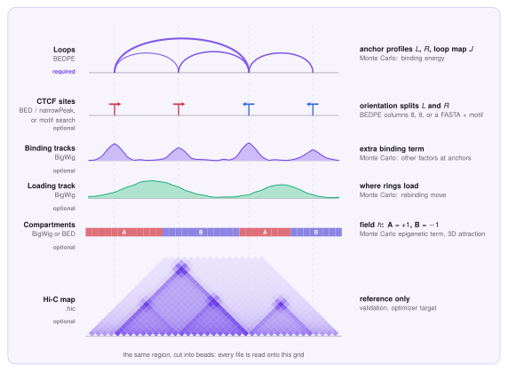

# Data input

This page lists the files LoopSage reads, what each one must look like, and which ones you need. In short: **one file with loops or peaks, and a region, are enough**. Everything else is optional and each optional file adds a feature.

All text files are plain **tab-separated** (spaces also work for BEDPE) with no header line. Lines starting with `#` are ignored. Coordinates are **0-based, half-open** (the BED convention), in base pairs. Chromosome names `chr1` and `1` are treated as the same.

## What you need

| Input | Required? | Format | Config key / CLI flag | What it gives |
|---|---|---|---|---|
| Loops or peaks | **Mandatory** | `.bedpe`, `.bed` or `.narrowPeak` | `interaction_file` / `-f` | Anchor sites and loop weights: the main input of the model |
| Region | **Mandatory** | `chr:start-end` | `chrom`, `region_start`, `region_end` / `-r` | The stretch of genome to simulate. Only `chrom` is strictly needed: without start and end the whole chromosome is used (with a warning) |
| Genome assembly | Optional | `hg38` or `hg19` | `genome` | Chromosome lengths. Default `hg38` |
| Hi-C map | Optional | `.hic` | `hic_file` / `--hic` | Reference for validation, and the target of the optimizer |
| BigWig binding tracks | Optional | `.bw` | `bw_files`, `bw_strengths` | Extra binding energy from other factors |
| Loading track | Optional | `.bw` | `lef_track_file` / `--lef-track` | Where extruders prefer to load |
| Compartments | Optional | `.bw` or `.bed` | `comp_bw_file` or `comp_bed_file` | A/B attraction in the 3D stage |
| Reference genome | Optional | FASTA (`.fa`, not compressed) | `motif_genome` / `--motif-genome` | CTCF motif search to set anchor orientations (BEDPE only) |
| Motif matrix | Optional | PFM text | `motif_pfm` / `--motif-pfm` | Replaces the bundled CTCF motif |
| Force field | Optional | OpenMM XML | `forcefield_path` | Replaces the bundled force field |
| Config file | Optional | `.ini` | `-c` | All settings in one file, see [Config files](config.md) |

!!! note "Minimal run"
    ```bash
    loopsage -f loops.bedpe -r chr1:77000000-95000000
    ```
    Nothing else is needed. The number of beads defaults to the region length divided by 2 kb (at least 10).

## Which data is used for what

LoopSage works in two steps, and the files feed different ones. In the **Monte Carlo** step the model decides *which sets of loops are likely*. In the **molecular dynamics** step it folds the polymer into 3D structures. The figure shows each file on one toy region; every file is first read onto the same grid of beads.

<figure markdown>
  { width="780" }
  <figcaption markdown="span">The input files on a toy region of 40 beads. The dashed lines mark the anchors. On the right is what each file becomes in the model.</figcaption>
</figure>

| Data | Which part of the model | In plain words |
|---|---|---|
| **Loops** (BEDPE) | Monte Carlo, binding energy | Says *where* loops can end and how strongly. Extruder legs are rewarded for sitting on anchors with many supporting reads |
| **CTCF sites** (BED, narrowPeak, motif search) | Monte Carlo, binding energy | Same idea when you have no loops, only binding sites. The orientation (forward or reverse) tells which leg of a ring may stop at the site |
| **Binding tracks** (BigWig) | Monte Carlo, extra binding term | Other proteins that stop or anchor extruders. Each track has its own strength |
| **Loading track** (BigWig) | Monte Carlo, rebinding move | Says where new rings are loaded. Without it, loading is uniform along the region |
| **Compartments** (BigWig or BED) | Monte Carlo epigenetic term and 3D attraction | Marks beads as A (active) or B (inactive). Like-type beads attract in the 3D step, so compartments separate. If you give none, they can be taken from the Hi-C map when the epigenetic model is on |
| **Hi-C map** (`.hic`) | Validation and optimizer | A *reference*, not an input of the simulation. It is compared with the predicted map, and `--optimize` tunes the energy coefficients to match it |
| **Reference genome and motif** | Preprocessing | Finds CTCF motifs in the anchors, so the orientation is known without columns 8 and 9 |
| **Force field** (XML) | Molecular dynamics | Defines the polymer (bonds, stiffness, excluded volume) |

!!! note "Loops versus peaks"
    A loop file tells the model *which pairs* of sites interact. A peak file only tells *which sites* exist, so the model predicts the loops itself. Give loops whenever you have them.

## Loops and peaks (mandatory)

LoopSage chooses the reader from the **file extension** (`.bedpe`, `.bed`, `.narrowPeak`, case-insensitive). Any other extension is an error. Only features that lie inside the region are used.

### BEDPE: loops

One loop per line, with both anchors. This is the usual output of loop callers and of ChIA-PET / HiChIP pipelines.

| Column | Content | Needed? |
|---|---|---|
| 1-3 | chromosome, start, end of the first anchor | yes |
| 4-6 | chromosome, start, end of the second anchor | yes |
| 7 | weight (PET count or score) | optional |
| 8 | probability that the first anchor is a **reverse** CTCF site | optional |
| 9 | the same for the second anchor | optional |

```text
chr14   23050000  23055000  chr14  23120000  23125000  18  0.08  0.92
chr14   23180000  23185000  chr14  23260000  23265000  42  0.15  0.88
```

- **Both anchors must lie inside the region.** Loops with an anchor outside are dropped, as are identical duplicates and lines whose coordinates are not numbers.
- **Weight** (column 7): stronger loops weigh more. Without it all loops count equally. `min_pet` / `--min-pet` keeps only loops with at least that weight.
- **Orientation** (columns 8, 9): a value in $[0,1]$ is the probability that the anchor is a reverse site, or `-1` for unknown. Without these columns, or for `-1`, an anchor counts as equally likely forward or reverse. You can have LoopSage fill them in from the genome sequence with `motif_genome` (see [below](#reference-genome-and-motif-optional)).

### BED: peaks

One binding site per line (for example CTCF ChIP-seq peaks). Loops are not given, so the sites define where loops may end.

| Column | Content | Needed? |
|---|---|---|
| 1-3 | chromosome, start, end | yes |
| 5 | score, used as the binding weight | optional |
| 7 | probability that the site is a **reverse** site (`-1` = unknown) | optional |

```text
chr14   23051200  23052800  site_1  1842  .  0.10
```

### narrowPeak: ENCODE peaks

The standard 10-column ENCODE peak format.

| Column | Content | Needed? |
|---|---|---|
| 1-3 | chromosome, start, end | yes |
| 5, 7 | score; `signalValue` (column 7) is preferred as the weight | optional |
| 10 | summit offset from the start; places the site on the bead of the summit | optional |
| 11 | optional extra column: probability that the site is a **forward** site (stored as reverse = 1 − value) | optional |

```text
chr14   23051200  23052800  peak_1  1842  .  18.23  187.42  184.20  780
```

!!! tip "Which one should I use?"
    Use **BEDPE** if you have loops, because the model then also learns which anchors are paired. Use **BED** or **narrowPeak** if you only have binding sites; the model then predicts the loops that these sites can make. `min_pet` and `motif_genome` work for BEDPE only.

## Hi-C map (optional)

A `.hic` file (Juicer format), read with the `hic-straw` package (installed with LoopSage). It is used as a reference to compare the predicted map to, and as the target for `--optimize`. It is never needed to run the model.

- LoopSage picks the file resolution closest to the bead size (`hic_resolution = 0`); set a bin size in bp to choose it yourself.
- `hic_norm` is `KR` by default. If that normalisation is missing it falls back to `SCALE`, `VC_SQRT`, `VC` and finally `NONE`.
- The map is rebinned onto the beads. Beads without data are masked, not treated as zero.
- A file that cannot be opened, or has no usable data for the region, stops the run with a clear message.

## BigWig tracks (optional)

Signal files (`.bw`, `.bigWig`) read with `pyBigWig`. The chromosome must exist in the file. Values are averaged per bead; negative values are set to zero. With `smoothing_input` on (default), they are smoothed slightly.

| Use | Key | Meaning |
|---|---|---|
| Binding tracks | `bw_files`, `bw_strengths` | One or more tracks (comma-separated) that add binding energy, for example other architectural proteins. `bw_strengths` gives one strength per track; if omitted, each track gets a default strength. A different number of strengths and tracks is an error |
| Loading track | `lef_track_file` | Where extruders are loaded, for example a cohesin loader ChIP-seq. Without it, loading is uniform |
| Compartments | `comp_bw_file` | An A/B signal, scaled to $[-1,1]$ (positive = A, negative = B) |

## Compartments as BED (optional)

An alternative to the BigWig: `comp_bed_file`. Give **only one** of `comp_bw_file` and `comp_bed_file`.

| Column | Content | Needed? |
|---|---|---|
| 1-3 | chromosome, start, end | yes |
| 4 | label starting with `A` or `B`; sub-compartments such as `A.1.2` are accepted | yes |
| 5 | score in $[0,1]$, mapped to $2\cdot\text{score}-1$ | optional |

```text
chr1   77000000  77900000  A  0.70  .
chr1   77900000  79750000  B  0.08  .
```

If no row overlaps the region, the run stops with an error.

## Reference genome and motif (optional)

With `motif_genome` set (BEDPE input only), LoopSage scans every anchor for CTCF motifs on both strands and writes the orientation probabilities for you, instead of reading columns 8 and 9.

- **FASTA**: an uncompressed reference genome (`.fa`, `.fasta`). A `.fai` index is built next to the file on the first use (if the folder is writable) and reused later. Compressed `.gz` files are not supported: decompress them first. Chromosome names are matched with or without `chr`. Anchors on a chromosome missing from the FASTA get no orientation.
- **PFM** (`motif_pfm`): by default the bundled JASPAR CTCF matrix (MA0139.1) is used. To use another motif, give a text file with **four rows** (A, C, G, T) of equal length. Plain numbers or the JASPAR style `A [ 4 19 ... ]` are both accepted, and `>` header lines are skipped.
- **Tuning**: `motif_pvalue` (hit cutoff, default $10^{-5}$, smaller is stricter), `motif_pseudocount` (default 0.8) and `motif_pad` (extend each anchor by this many bp).

## Force field (optional)

`forcefield_path` points to an OpenMM force-field XML. The bundled one is used by default, and you only need your own to change the polymer model itself.

## What happens when something is wrong

| Situation | Result |
|---|---|
| No `interaction_file`, or the file does not exist | Error, run stops |
| Extension is not `.bedpe`, `.bed` or `.narrowPeak` | Error |
| No chromosome given, or an unknown chromosome | Error |
| Region start/end missing | Whole chromosome used, with a warning |
| Both `comp_bw_file` and `comp_bed_file` | Error |
| `bw_strengths` count differs from `bw_files` count | Error |
| `min_pet` or `motif_genome` with BED / narrowPeak | Error |
| `motif_genome` or `motif_pfm` file missing | Error |
| Orientation columns that are not probabilities | Warning, columns ignored |
| `min_pet` set but BEDPE has no weight column | Warning, filter skipped |
| `.hic` cannot be read | Error with the reason |

## The same inputs in Python

In the [Python interface](python.md) the inputs are passed to `read_inputs`, either as file paths or as arrays (useful for synthetic data).

```python
import loopsage as ls

cfg = ls.config(region="chr1:77000000-95000000", n_beads=120)
geom = ls.geometry(cfg)

# from files
inputs = ls.read_inputs(cfg, geom, loops="loops.bedpe",
                        compartments="comps.bed", tracks=["ctcf.bw"], lef_track="nipbl.bw")

# from arrays (positions in bp)
inputs = ls.read_inputs(cfg, geom, loops=(left, right, weight))
inputs = ls.read_inputs(cfg, geom, sites=dict(position=pos, weight=w, reverse=p))
```

Give `loops` or `sites`, not both. See the [config page](config.md) for every key and the [Preprocessing](../implementation/preprocessing.md) page for how the inputs become bead profiles.
