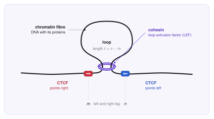
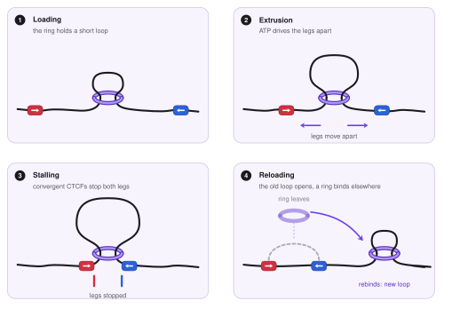
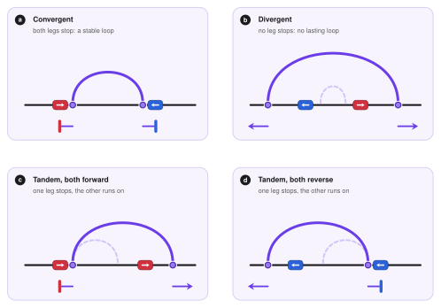
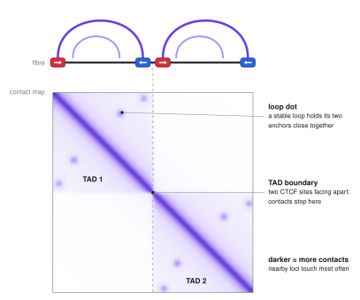
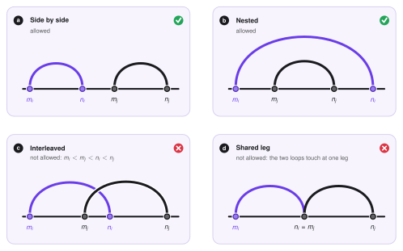
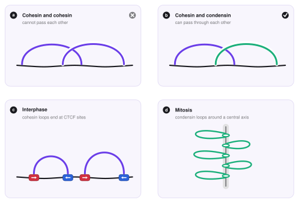

# Loop extrusion

This page explains **loop extrusion**, the process that folds chromatin into loops.
It is about the biology and the basic ideas only. The energy function and the sampling algorithm of LoopSage come in the next sections.
The boxes called *In LoopSage* just point to the settings where each idea appears in the program.

## The big picture

A human cell has about two metres of DNA that must fit into a nucleus a few micrometres wide.
The DNA is therefore folded, and the folding is not random: places that are far apart along the DNA are often brought next to each other, and this controls which genes talk to which regulatory elements.
One of the main folding mechanisms is **loop extrusion**.
Imagine a ring that is threaded onto a rope and starts to slide along it while pulling the rope through itself: a loop of rope grows on one side of the ring.
In the cell the ring is a protein complex, and the rope is the chromatin fibre.

## The players

**The chromatin fibre** is the DNA together with the proteins it is wrapped around.
Over distances of thousands of bases it behaves like a long flexible rope. In all figures it is the **black line**.

**Cohesin** is a ring-shaped protein complex that works as a molecular motor.
It holds the fibre at two points, and using the energy of ATP it moves these two points apart, pulling more and more fibre through itself.
We call such a motor a **loop extrusion factor**, or **LEF**.
In the figures cohesin is the **purple ring**.

**CTCF** is a protein that sticks to the DNA at places with a specific sequence, the *CTCF motif*.
The motif has a **direction**, like a one-way arrow written along the DNA: it can point right (**red**) or left (**blue**).
CTCF acts as a **boundary element**: a place where cohesin tends to stop.

**Condensin** is a cohesin relative that works when the cell divides. It is also a ring that extrudes loops, and in the figures it is **green**. We meet it at the end of this page.

<figure markdown>
  { width="640" }
  <figcaption>One chromatin loop held by cohesin. The ring encircles the two strands at the base of the loop. The loop is the piece of fibre between the two legs of the ring, at positions <i>m</i> and <i>n</i>. Two CTCF proteins sit at the base, one pointing right (red) and one pointing left (blue).</figcaption>
</figure>

## The loop extrusion model

The **loop extrusion model** (Sanborn et al. 2015, Fudenberg et al. 2016) proposes that a loop is not made by two faraway places that happen to meet.
Instead, a cohesin ring sits on the fibre and **reels it in from both sides**, so the loop keeps growing until the ring is stopped by something.

<figure markdown>
  { width="780" }
  <figcaption>The life of one loop. <b>1</b> A ring holds a short loop. <b>2</b> Driven by ATP, its two legs move apart and the loop grows. <b>3</b> Two CTCFs that face each other stop the legs. <b>4</b> After some time the ring unloads and binds somewhere else, and the old loop is released.</figcaption>
</figure>

### How we describe a loop

Let us cut the studied region into small equal pieces, called **beads** (for example 5 000 bases each), and number them $1, 2, \dots, N$.
A cohesin ring has two legs, so one LEF is described by two bead numbers,

$$
(m, n), \qquad m < n ,
$$

the position of its **left leg** $m$ and its **right leg** $n$.
The loop is everything between the legs, so its size in beads is simply

$$
\ell = n - m .
$$

If there are $N_{\mathrm{lef}}$ rings on the region, the whole system at one moment is just a list of $N_{\mathrm{lef}}$ pairs $(m,n)$.
This short list is all that the stochastic model of the next sections has to keep track of.

### What a LEF does

The ring is always on the fibre, and its life is a short cycle.

1. **It holds a small loop.** A freshly placed ring holds a very short piece of fibre, a loop of one or two beads.
2. **It extrudes.** The legs slide along the fibre: the left leg moves left ($m \to m-1$) and the right leg moves right ($n \to n+1$). The loop grows. In experiments this happens at about one thousand bases per second (Davidson et al. 2019; Kim et al. 2019).
3. **It stops** when a leg meets a barrier: a CTCF with the right orientation, or another ring. The other leg may still move.
4. **It unloads and rebinds.** After some time the ring leaves the fibre, the loop is released, and a ring binds again somewhere else. In a living cell the number of rings on the fibre stays roughly constant, so we can think that every ring that leaves is replaced at once.

The fuel is **ATP**, the energy currency of the cell. Each step of the ring uses a little ATP, and without it no loops are made (Ganji et al. 2018; Davidson et al. 2019).
We do not follow this chemistry in detail. We only keep its result: legs that keep moving outward.

!!! note "In LoopSage"
    The number of rings is `n_lef`, and the region is cut into `n_beads` beads.
    A Monte Carlo step either slides the legs of one ring or lets the ring unbind and rebind at a new place, so all `n_lef` rings are always on the fibre.
    By default the new place is random; `lef_track_file` (cohesin ChIP-seq signal) makes some places more likely.

### What the model assumes

The picture above rests on a few simple assumptions.

1. **More extrusion than sinking.** On average the legs move *outward*, so loops grow rather than shrink. In the simplest version a leg only moves outward. In a more general version a leg does a random walk with a drift, so it can also step back sometimes.
2. **Motion is one-dimensional.** A leg moves only along the fibre, like a bead on a string. Three-dimensional space matters later, when the loops are folded into a 3D structure.
3. **Rings do not cross.** Two cohesin rings cannot pass through each other (see below).
4. **CTCF is a one-way barrier.** It only stops a leg that comes from the correct side (see below).
5. **Rings live longer at barriers.** A ring that is stopped by a CTCF pair is protected from being removed, so it stays much longer than a ring that is just sliding. This is why the loops anchored at CTCF are the ones that dominate experimental data. Typically CTCF stays on DNA for minutes and cohesin for tens of minutes (Hansen et al. 2017).
6. **The data are averages.** An experiment measures millions of cells at once, each with its own loops. The model therefore describes a *population* of possible loop arrangements, not one fixed picture.

!!! note "In LoopSage"
    `lef_rw = true` means that legs do a random walk; `false` means that they only extrude outward.
    `lef_speed` lets different rings move at different speeds.

## How CTCF stops cohesin

CTCF stops cohesin in one direction only.
A **forward** CTCF (red) stops a leg that is moving *left*, head-on towards the arrow tip, and a **reverse** CTCF (blue) stops a leg that is moving *right*.
So the two CTCFs at the ends of a loop must **face each other** (this is called *convergent*) to stop both legs.

<figure markdown>
  { width="760" }
  <figcaption>Four arrangements of two CTCF sites. The pale dashed arc is the loop when the ring starts; the solid arc is the final loop. <b>a</b> Facing each other: both legs stop. <b>b</b> Facing away: nothing stops. <b>c, d</b> Same direction: one leg stops, the other keeps going.</figcaption>
</figure>

This is exactly what is seen in data: loops with CTCF at both ends are mostly convergent (Rao et al. 2014; de Wit et al. 2015; Guo et al. 2015).
If the two sites point in the same direction, one leg is free and keeps extruding, which makes a line of enriched contacts called a **stripe**.
If they face away from each other, no loop is kept.

To use this in a model we only need to say, for every bead $k$, how strongly it stops a left leg, $L(k)$, and how strongly it stops a right leg, $R(k)$.
Beads that are not CTCF sites have $L(k)=R(k)=0$.
The direction of each site is read from the DNA sequence of its motif.

!!! note "In LoopSage"
    The anchors in the input BEDPE file become the profiles $L(k)$ and $R(k)$.
    If the file has orientation columns (8 and 9) they are used directly; otherwise `motif_genome` switches on the CTCF motif search (`motif_pfm`, `motif_pvalue`) that finds the orientation of every anchor.
    With `data_loss_mode = 1` the barriers are given as a 2D map of loops $(m,n)$ instead of two 1D profiles.

## Loops, TADs and contact maps

Hi-C is an experiment that counts how often two places of the genome touch each other.
The result is a **contact map**: a square picture in which the pixel $(i,j)$ is darker when places $i$ and $j$ touch more often.
Loop extrusion leaves two clear marks on it.

- **Loop dots.** The two ends of a stable loop are held together, so they touch more often than expected and make a dark dot, usually at the corner of a square.
- **TADs** (topologically associating domains; Dixon et al. 2012, Nora et al. 2012). These are squares along the diagonal. Inside a TAD, rings keep reeling in the whole region, so every place touches every other one. Across a TAD boundary contacts are rare. A boundary is often a **pair of CTCFs facing away from each other**, because neither lets rings from the other side come through.

<figure markdown>
  { width="640" }
  <figcaption>Top: the fibre with loops of cohesin (nested loops inside two TADs) and CTCFs at the domain ends. Bottom: the contact map this arrangement would give. The two squares along the diagonal are TADs, and the dots are loops.</figcaption>
</figure>

Experiments agree with this picture: when cohesin is removed, loops and TADs disappear, and when CTCF is removed, domains lose their sharp edges (Rao et al. 2017; Nora et al. 2017).
Cohesin makes the loops, and CTCF decides where they stop.

## Rings do not cross

The fibre passes through the ring, so two rings on the same fibre cannot pass through one another.
For two loops $(m_i,n_i)$ and $(m_j,n_j)$ this means that they can lie **side by side** or **one inside the other**, but they cannot be **interleaved**, and they cannot share a leg.

<figure markdown>
  { width="760" }
  <figcaption>Two cohesin loops. Side by side and nested loops are allowed. Interleaved loops (the legs alternate: <i>m</i>i &lt; <i>m</i>j &lt; <i>n</i>i &lt; <i>n</i>j) and loops that share a leg are not.</figcaption>
</figure>

As a result, rings push against each other and cannot all collapse into the same loop. They form a chain of neighbouring and nested loops, and the outer legs stay pressed against the next barrier.

!!! note "In LoopSage"
    The interleaved case can be switched on or off with `cross_loop`, and the strictness is set by `cross_coeff`.

## Condensin and mitosis

When a cell divides, each chromosome must become a compact rod that can be moved safely into a daughter cell.
For this the cell uses **condensin** (two forms, I and II).
Like cohesin, condensin is an ATP-driven ring that extrudes loops (Ganji et al. 2018), but with three differences.

1. **Longer loops.** Condensin makes loops of roughly a hundred thousand to a few hundred thousand bases, arranged in nested arrays along the chromosome (Goloborodko et al. 2016; Gibcus et al. 2018).
2. **No CTCF stops.** In mitosis CTCF and most cohesin leave the chromosome arms. The condensin loops are not anchored at fixed motifs and form a dense *bottle-brush* around a central axis. TADs and CTCF loops disappear from the contact map.
3. **They can pass cohesin.** Single-molecule experiments show that condensin rings can pass through each other and through other ring complexes (Kim et al. 2020). A cohesin loop and a condensin loop can therefore be interleaved.

<figure markdown>
  { width="700" }
  <figcaption><b>a</b> Two cohesins cannot pass each other. <b>b</b> A cohesin (purple) and a condensin (green) can. <b>c</b> In interphase, cohesin loops end at CTCF sites. <b>d</b> In mitosis, condensin loops sit around a central axis and do not depend on CTCF.</figcaption>
</figure>

!!! note "In LoopSage"
    A second group of extruders is added with `n_lef2`, next to the first group `n_lef`.
    Setting `between_families_penalty = false` lets the two groups pass through each other, while rings of the same group still cannot.

## Summary

- A **LEF** (cohesin) sits on the fibre and reels it in from both sides. Its state is just a pair of legs $(m,n)$, and the loop size is $\ell=n-m$.
- **CTCF** is a one-way barrier: facing sites stop both legs and make stable loops, sites in the same direction make stripes.
- **TADs** and **loop dots** in Hi-C maps are the average footprint of many rings stopped at CTCF boundaries.
- Cohesin rings do not cross each other, but **condensin**, which builds the long nested loops of mitotic chromosomes, can pass through cohesin.

## References

- Sanborn A. L. et al. (2015). Chromatin extrusion explains key features of loop and domain formation in wild-type and engineered genomes. *PNAS* 112, E6456.
- Fudenberg G. et al. (2016). Formation of chromosomal domains by loop extrusion. *Cell Reports* 15, 2038.
- Goloborodko A., Imakaev M. V., Marko J. F., Mirny L. (2016). Compaction and segregation of sister chromatids via active loop extrusion. *eLife* 5, e14864.
- Rao S. S. P. et al. (2014). A 3D map of the human genome at kilobase resolution reveals principles of chromatin looping. *Cell* 159, 1665.
- de Wit E. et al. (2015). CTCF binding polarity determines chromatin looping. *Molecular Cell* 60, 676.
- Guo Y. et al. (2015). CRISPR inversion of CTCF sites alters genome topology and enhancer/promoter function. *Cell* 162, 900.
- Dixon J. R. et al. (2012). Topological domains in mammalian genomes identified by analysis of chromatin interactions. *Nature* 485, 376.
- Nora E. P. et al. (2012). Spatial partitioning of the regulatory landscape of the X-inactivation centre. *Nature* 485, 381.
- Rao S. S. P. et al. (2017). Cohesin loss eliminates all loop domains. *Cell* 171, 305.
- Nora E. P. et al. (2017). Targeted degradation of CTCF decouples local insulation of chromosome domains from genomic compartmentalization. *Cell* 169, 930.
- Hansen A. S. et al. (2017). CTCF and cohesin regulate chromatin loop stability with distinct dynamics. *eLife* 6, e25776.
- Ganji M. et al. (2018). Real-time imaging of DNA loop extrusion by condensin. *Science* 360, 102.
- Davidson I. F. et al. (2019). DNA loop extrusion by human cohesin. *Science* 366, 1338.
- Kim Y. et al. (2019). Human cohesin compacts DNA by loop extrusion. *Science* 366, 1345.
- Kim E. et al. (2020). DNA-loop extruding condensin complexes can traverse one another. *Nature* 579, 438.
- Gibcus J. H. et al. (2018). A pathway for mitotic chromosome formation. *Science* 359, eaao6135.
