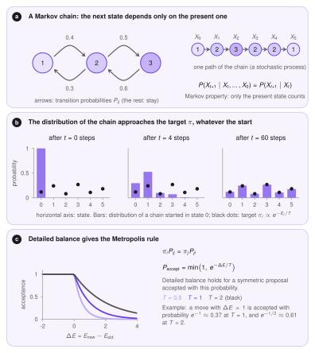
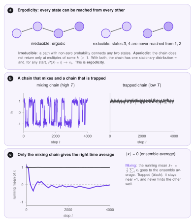
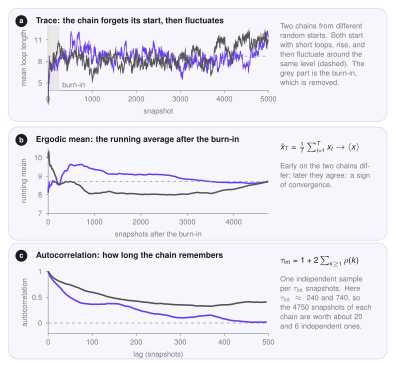

# Markov chain Monte Carlo

The sum $Z=\sum_x e^{-E(x)/T}$ over *all* sets of loops is far too large to compute, and so is any average over the Boltzmann distribution. **Markov chain Monte Carlo** (MCMC) avoids the problem. It produces a long random sequence of states whose frequencies approach the Boltzmann probabilities, and then takes averages along the sequence. This page explains why that works and how to tell whether it worked in your run.

## Stochastic process and Markov chain

A **stochastic process** is a sequence of random states $X_0,X_1,X_2,\dots$, one for each time step. In general, each state could depend on the whole past. A **Markov chain** is a process with a short memory: the next state depends only on the present one,

$$
P(X_{t+1}\mid X_t,X_{t-1},\dots,X_0)=P(X_{t+1}\mid X_t).
$$

The chain is described by its **transition probabilities** $P_{ij}=P(X_{t+1}=j\mid X_t=i)$. In LoopSage a state is the whole set of loops, and a step is one attempted move (a slide, a rebinding or an epigenetic change). The past matters only through the current loops, which is what makes the chain Markov. The *samples* are nevertheless correlated, because consecutive states differ by only one move. We return to this in the section on autocorrelation.

## Which distribution does the chain reach?

A **stationary distribution** $\pi$ is one that does not change under a step: if $X_t\sim\pi$, then $X_{t+1}\sim\pi$. The **initial distribution** is the distribution of $X_0$; in LoopSage it is a random start with loops placed at random. We want a chain whose stationary distribution is the Boltzmann law, $\pi_i\propto e^{-E_i/T}$, and which forgets its start.

**Detailed balance** is a convenient way to guarantee the first part. If $\pi_iP_{ij}=\pi_jP_{ji}$ for every pair of states, then $\pi$ is stationary. The **Metropolis rule** achieves this: propose a move to state $j$ with a symmetric proposal, and accept it with probability

$$
\min\!\big(1,\,\pi_j/\pi_i\big)=\min\!\big(1,\,e^{-\Delta E/T}\big),\qquad \Delta E=E_j-E_i .
$$

Moves that lower the energy are always accepted. Moves that raise it are accepted with a probability that falls as $\Delta E$ grows and rises as $T$ grows. Only the *difference* of energies enters, so the partition function $Z$ is never needed.

!!! tip "Intuition"
    Think of a hiker who wants to visit places in proportion to how comfortable they are. The hiker always accepts a step downhill, and sometimes accepts a step uphill, more willingly when it is only a small climb or when the weather is warm (high $T$). Walking like this for long enough, the time spent at each place matches its Boltzmann probability, even though the hiker never sees the whole map.

<figure markdown>
  { width="780" }
  <figcaption markdown="span"><b>a</b> A three-state Markov chain and its transition probabilities. <b>b</b> A chain started in one state approaches the target distribution (dots). <b>c</b> The Metropolis acceptance as a function of $\Delta E$ for three temperatures.</figcaption>
</figure>

## Ergodicity

The second part, forgetting the start, is called **ergodicity**. A chain is ergodic if it is

- **irreducible**: from every state there is a path with non-zero probability to every other state, so no region of states is cut off;
- **aperiodic**: it does not return to a state only at multiples of some period $k>1$.

For such a chain the stationary distribution is unique, and for any start $P(X_t=i)\to\pi_i$. In LoopSage the moves can reach any arrangement of loops (a ring can unbind and load anywhere), and the chance to stay in the same state keeps the chain aperiodic, so the chain is ergodic in principle.

*In principle* is not the same as *in practice*. A chain can be ergodic and still be **trapped** for a very long time. At low temperature the sampler may stay in one valley of the energy landscape, because leaving it requires a move that the Metropolis rule almost never accepts. This is why LoopSage uses **annealing**: it starts hot, where barriers are easy to cross, and then cools down so that the chain settles in a deep valley.

<figure markdown>
  { width="780" }
  <figcaption markdown="span"><b>a</b> A chain on a connected graph is irreducible; a disconnected one is not. <b>b</b> A chain on a double well mixes at a high temperature and is trapped at a low one. <b>c</b> The running mean reaches the ensemble average only for the mixing chain.</figcaption>
</figure>

## Ergodic means

An **ergodic mean** is the average of a quantity $x_t=f(X_t)$ along the chain,

$$
\bar x_T=\frac1T\sum_{t=1}^{T}x_t \;\longrightarrow\; \langle x\rangle=\sum_i \pi_i f(i)\qquad (T\to\infty).
$$

The right-hand side is the **ensemble average**, the average over the Boltzmann distribution. The ergodic theorem says that the time average along one long ergodic chain equals it. This is what makes the whole method work: we never sum over all states, we simply average over snapshots.

Almost everything LoopSage reports is an ergodic mean over the snapshots after the burn-in: the **contact map** implied by the loops, the **mean loop length**, the **unfolded fraction**, the average of each **energy term**, the occupancy of each bead by a loop leg, and the insulation or stripe profiles computed from the averaged map. The averaged **MD contact map** is the same kind of quantity, taken over the 3D frames. These numbers are meaningful when the chain has converged and the number of snapshots is large compared with the correlation time.

What is *not* an ergodic mean: a single snapshot, the last snapshot, the minimum energy found, and any average that includes the burn-in or the annealing phase (the chain is not stationary there).

## Reading a run: the burn-in

A chain that starts away from the typical states first *drifts*, and only later fluctuates around a constant level. The drifting part is called the **burn-in**, and it is discarded. The mean loop length is a good indicator: at the start the rings are short, then it rises, and in equilibrium it should stay almost **constant with fluctuations**. A curve that keeps rising or falling is not equilibrated.

<figure markdown>
  { width="780" }
  <figcaption markdown="span">Two real LoopSage chains (Metropolis, $T=1$, 250 beads, 39 extruders, 200 000 steps, one snapshot per 40 steps). <b>a</b> The trace of the mean loop length. <b>b</b> The running mean after the burn-in. <b>c</b> The autocorrelation function. Purple is chain 1 and black is chain 2.</figcaption>
</figure>

## Autocorrelation: how long the chain remembers

Consecutive snapshots are similar, so the samples are *not* independent. The **autocorrelation function** measures how similar a quantity is to itself after a delay of $k$ snapshots (the *lag*),

$$
\rho(k)=\frac{\operatorname{cov}(x_t,\,x_{t+k})}{\operatorname{var}(x_t)},\qquad \rho(0)=1 .
$$

**How to read it.** $\rho(k)=1$ means that the two values are identical, $\rho(k)=0$ means that they are unrelated, and a negative value means that they tend to be opposite. A plot of $\rho$ against $k$ starts at 1 and decays. The lag at which it reaches about 0 is the time after which the chain has forgotten where it was, so samples further apart than that are practically independent. A curve that stays high for hundreds of lags tells you that the chain moves slowly through the states.

The decay is summarised by the **integrated autocorrelation time**,

$$
\tau_{\mathrm{int}}=1+2\sum_{k\ge1}\rho(k),
$$

which is the number of snapshots that are worth *one* independent sample. With $T$ snapshots, the **effective sample size** is

$$
\mathrm{ESS}=\frac{T}{\tau_{\mathrm{int}}},
$$

and the error of an ergodic mean is about $\sigma/\sqrt{\mathrm{ESS}}$, where $\sigma$ is the standard deviation of the quantity. In the figure above $\tau_{\mathrm{int}}\approx240$ and $740$ snapshots, so each chain of 4750 snapshots after the burn-in is worth only about 20 and 6 independent samples of the mean loop length. This is the honest measure of how much the run really knows.

!!! tip "In practice"
    Plot the trace: it should fluctuate around a constant after the burn-in. Run two chains from different random starts (`replicas`): their running means must agree, as in panel b. Read $\tau_{\mathrm{int}}$ off the autocorrelation: if it is a large share of the run, increase `n_steps`, not only the number of snapshots (saving more often adds correlated samples, not new ones). The [Monte Carlo](../implementation/monte-carlo.md) page lists the settings, and the report shows the drift of the energy between the two halves of the run.
