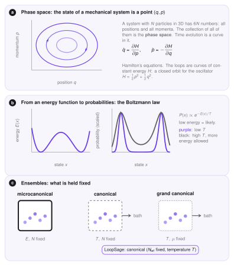
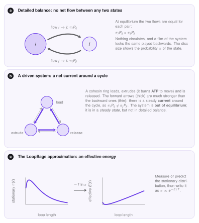

# Mechanics of LoopSage

LoopSage assigns an **energy** to every set of loops and samples sets with probability $\propto e^{-E/T}$. This page explains where that idea comes from, why it is only an *approximation* for a living cell, and what is kept from the exact theory. New words are defined when they appear.

## The mechanical Hamiltonian

In classical mechanics a system of $N$ particles is described by the positions $q$ and momenta $p$ of all particles. Together they form a point $(q,p)$ in the **phase space**, a space with $6N$ coordinates (three positions and three momenta per particle). The **Hamiltonian** $H(q,p)$ is the total energy as a function of this point: kinetic plus potential, for example $H=\tfrac12p^2+\tfrac12q^2$ for an oscillator. It determines the motion through **Hamilton's equations**,

$$
\dot q=\frac{\partial H}{\partial p},\qquad \dot p=-\frac{\partial H}{\partial q},
$$

where a dot is the derivative with respect to time. The system moves along a curve of constant energy.

This needs $H$ to be **differentiable**: the force is the derivative of the energy, so a smooth landscape gives a well-defined motion. The energy of the loop model is not like that. A loop has integer positions $(m,n)$ on a grid of beads, so there is no derivative, and the loops do not follow equations of motion. Loop extrusion in LoopSage is a **statistical** model, and for it only a weaker notion of Hamiltonian is kept.

<figure markdown>
  { width="780" }
  <figcaption markdown="span"><b>a</b> A mechanical state is a point in phase space and moves along a curve of constant energy. <b>b</b> An energy landscape turns into probabilities by the Boltzmann law; a higher temperature allows higher energies. <b>c</b> Ensembles differ by what is held fixed.</figcaption>
</figure>

## The statistical Hamiltonian

In statistical physics the *Hamiltonian* can be any function $E(x)$ that gives the energy of a state $x$, with no need for derivatives or motion. Then the probability of a state at temperature $T$ is the **Boltzmann law**,

$$
P(x)=\frac{1}{Z}\,e^{-E(x)/T},\qquad Z=\sum_x e^{-E(x)/T}.
$$

$Z$ is the *partition function*, the number that makes the probabilities sum to one. Low-energy states are likely, and $T$ sets how much higher energy is tolerated. In LoopSage $T$ is in arbitrary units, because the energy itself is made of effective terms (folding, binding, crossing) and not of physical joules. A state $x$ is the complete set of loops $\{(m_i,n_i)\}$, possibly with the epigenetic states of the beads.

## Ensembles

An **ensemble** is the set of all states together with their probabilities, for a given set of conditions. The three classical ones differ in what is held fixed.

| Ensemble | Fixed | Exchanges with the outside |
|---|---|---|
| microcanonical | energy $E$, particle number $N$ | nothing (isolated) |
| canonical | temperature $T$, particle number $N$ | energy (a heat bath) |
| grand canonical | temperature $T$, chemical potential $\mu$ | energy and particles |

LoopSage uses the **canonical ensemble**: the number of extruders $N_{\mathrm{lef}}$ is fixed, and the temperature $T$ controls the fluctuations. This is why the Boltzmann law above is the right distribution, and why the Metropolis rule on the [Monte Carlo](../implementation/monte-carlo.md) page works. The grand canonical alternative, with extruders appearing and disappearing, is mimicked by the *rebinding* move, where one ring is removed and another loaded.

## A cell is not in equilibrium

The Boltzmann law describes a system in **equilibrium**. A cohesin ring is not in equilibrium: it burns ATP to extrude, and it loads and unloads in a cycle. This is a *driven* system.

What distinguishes equilibrium is **detailed balance**. Let $\pi_i$ be the probability of state $i$ and $P_{ij}$ the probability to jump from $i$ to $j$ in one step. Detailed balance says that for every pair of states the two flows are equal,

$$
\pi_i\,P_{ij}=\pi_j\,P_{ji}.
$$

Nothing circulates: a film of the system looks the same played backwards. In a driven cycle (load, extrude, release) the forward flow is much larger than the backward one, so there is a steady current and detailed balance is broken. The system is then in a **steady state**: the probabilities $\pi$ do not change with time, but they are not Boltzmann probabilities.

<figure markdown>
  { width="780" }
  <figcaption markdown="span"><b>a</b> Detailed balance: equal flows for every pair. <b>b</b> A driven cycle has a net current, so it is out of equilibrium. <b>c</b> LoopSage takes the stationary distribution and writes it as an effective energy.</figcaption>
</figure>

## The LoopSage approximation

LoopSage does not model the driving. It turns the problem around: *whatever the stationary distribution $\pi$ of the loops is, write it as*

$$
\pi(x)\propto e^{-E(x)/T}.
$$

The energy is then an **effective energy**, $E=-T\ln\pi$ up to a constant: it is not the physical energy of the ring but a compact way of saying which loop sets are likely. The terms of $E$ are chosen to reproduce what is observed. Long loops are favoured (folding), legs prefer CTCF sites (binding), and crossing loops are forbidden (crossing). The coefficients are fitted by the [optimizer](../implementation/optimizer.md) to Hi-C or to the input loops.

This is an approximation with a clear limit. Equilibrium sampling gives the right *average map* and the right fluctuations if the effective energy is right, but it does not give the **dynamics**: the sampler's steps are not real time, and currents such as the directed motion of a ring are replaced by random-walk moves. Questions about speed, residence times or the order of events need a model with real kinetics.

## How detailed balance is approximated

The sampler ([MCMC](mcmc.md)) is built so that it satisfies detailed balance with respect to $e^{-E/T}$ by construction: a proposed move is accepted with the Metropolis probability, which makes $\pi_iP_{ij}=\pi_jP_{ji}$ for the target distribution. Three choices keep this approximately true in practice.

- **Symmetric proposals.** Sliding by $\pm1$ is as likely as the reverse move, so the proposal does not bias the result.
- **Rebinding as an approximation.** The rebinding move (load a minimal loop anywhere) is not exactly the reverse of the extrusion, so it is a loading process rather than an exactly balanced move. With uniform loading it is close to symmetric. A loading track makes it deliberately biased towards the real loading sites.
- **Annealing.** With `method = Annealing` the temperature changes during the run, so the chain is not stationary until the end. Only the snapshots after the burn-in, when the temperature is close to its final value, are used for statistics.

!!! note "In LoopSage"
    The energy terms and the temperature are described in [Monte Carlo](../implementation/monte-carlo.md). The next page explains why the sampler converges to the Boltzmann distribution and how to check that it did.
