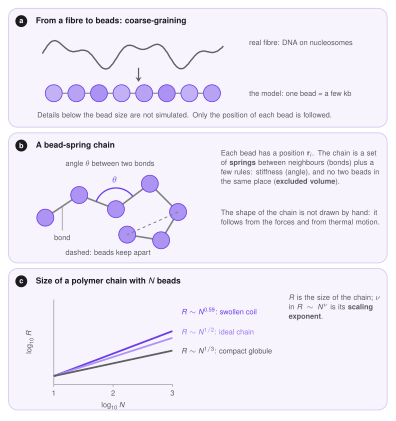
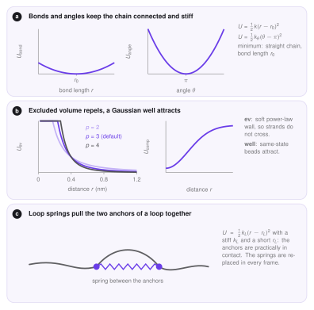
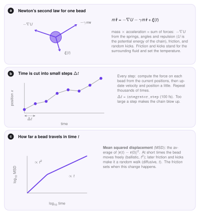

# Molecular dynamics of the polymer

The Monte Carlo stage gives *sets of loops*. This page explains the physics that turns them into 3D structures: how chromatin is represented as a polymer, which forces act on it, and how Newton's second law moves it. The settings are on the [Molecular Dynamics](../implementation/molecular-dynamics.md) implementation page.

## Polymer representation

A chromatin fibre has billions of atoms, and following them all is impossible and unnecessary. We **coarse-grain**: a stretch of a few kilobases is replaced by one **bead**, and only the positions $\mathbf r_i$ of the beads are followed. Everything finer than a bead is averaged out. The result is a **bead-spring chain**: neighbouring beads are connected by springs (bonds), and extra terms make the chain stiff and prevent beads from overlapping.

<figure markdown>
  { width="780" }
  <figcaption markdown="span"><b>a</b> The fibre is replaced by beads. <b>b</b> A bead-spring chain with bonds, angles and excluded volume. <b>c</b> The size $R$ of a chain of $N$ beads grows as $N^\nu$; the exponent $\nu$ depends on how crowded the chain is.</figcaption>
</figure>

The **size** of a chain is measured by the radius of gyration $R$ (the typical distance of the beads from the centre). It follows a power law $R\sim N^{\nu}$ in the number of beads. An ideal chain that ignores itself has $\nu=1/2$, a chain with excluded volume swells to about $\nu\approx0.59$, and a compact globule has $\nu=1/3$. Chromatin in the nucleus is closer to the compact end, which is why loops and attractive forces matter.

## The force field

A **force field** is the list of potential energies $U$ of the model. The force on bead $i$ is $\mathbf F_i=-\nabla_i U$, the slope of the energy landscape pointing downhill. LoopSage uses these terms for chromatin.

**Bonds** keep neighbours at distance $r_0$ with a harmonic spring, $U=\tfrac12k(r-r_0)^2$. The constant $k$ is large, so the chain is practically inextensible.

**Angles** give the fibre a stiffness: $U=\tfrac12k_\theta(\theta-\pi)^2$ is lowest when three neighbouring beads lie on a straight line ($\theta=\pi$). A small $k_\theta$ gives a flexible fibre, a large one a stiff rod.

**Excluded volume** is a repulsion at short distance. Without it the chain can pass through itself, which is not possible for a real fibre. LoopSage uses a soft power law, $U_{\mathrm{ev}}\propto(\cdot/(r+r_s))^{p}$, whose steepness is set by $p$. A softer wall allows strands to cross, which is related to what topoisomerases do (see [Topology](topology.md)).

**Loop springs** are the link to the Monte Carlo. For every loop of the current snapshot, the two anchor beads are connected by a stiff spring with a short rest length, so they sit next to each other and the fibre between them forms a loop.

**Compartment attraction** (optional) is a Gaussian well $U=-s\,e^{-r^2/2w^2}$ between beads of the same epigenetic state: same-type chromatin attracts, so A and B domains separate.

<figure markdown>
  { width="780" }
  <figcaption markdown="span"><b>a</b> The harmonic bond and angle potentials. <b>b</b> The excluded-volume wall for three exponents, and the Gaussian well of the compartments. <b>c</b> A loop spring between two anchors.</figcaption>
</figure>

## Newton's second law and the Langevin equation

Newton's second law says that mass times acceleration equals the total force. For a bead in a viscous fluid there are two more forces besides $-\nabla U$: a **friction** $-\gamma m\dot{\mathbf r}$ that slows the bead, and **random kicks** $\boldsymbol\xi(t)$ from collisions with the surrounding molecules,

$$
m\,\ddot{\mathbf r}=-\nabla U-\gamma m\,\dot{\mathbf r}+\boldsymbol\xi(t).
$$

This is the **Langevin equation**. The friction coefficient $\gamma$ and the strength of the kicks are tied together (the *fluctuation–dissipation relation*), and together they set the temperature of the system: the heat bath. The beads then sample positions with probability $\propto e^{-U/k_BT}$, the same Boltzmann law as in the [Mechanics](mechanics.md) page, now for the shape of the polymer given the loops.

<figure markdown>
  { width="780" }
  <figcaption markdown="span"><b>a</b> The forces on one bead. <b>b</b> Time is cut into steps $\Delta t$. <b>c</b> The mean squared displacement grows as $t^2$ at short times and as $t$ at long times.</figcaption>
</figure>

## Time stepping

The equation cannot be solved exactly, so time is cut into small steps $\Delta t$. In each step the forces are computed from the current positions, and velocities and positions are updated a little. After many steps the chain has moved. The step must be small compared with the fastest motion (the vibration of the stiff bonds and loop springs), otherwise the numbers grow without bound and the simulation blows up. Friction makes the dynamics **overdamped** at long times: the mean squared displacement of a bead grows as $t^2$ at short times (free flight) and as $t$ at long times (diffusion).

## Why MD after Monte Carlo

The Monte Carlo has no geometry, it only knows which beads are tied. MD adds the missing physics: the fibre has a thickness, cannot cross itself, and has stiffness, so loops compete for space. Between two Monte Carlo snapshots the loops change little, so the chain is not restarted but *relaxed* from the previous structure for a number of steps with the new springs. The set of frames is the 3D ensemble, and its average is again an ergodic mean (see [MCMC](mcmc.md)).
