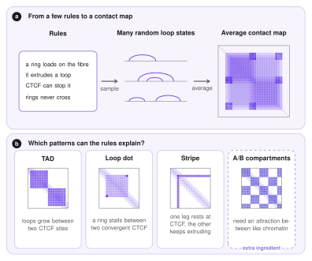

# Scope: what the model explains

Before the details, one question: *what do we want from a model of loop extrusion?* This page sets the goal and the logic of the approach. The next pages explain the physics ([Mechanics](mechanics.md)), the sampling ([MCMC](mcmc.md)) and the 3D polymer ([Molecular dynamics](molecular-dynamics.md)). For the biology of cohesin and CTCF see [Loop extrusion](loop-extrusion.md).

## From rules to a heatmap

A Hi-C map is a matrix: entry $(i,j)$ counts how often two regions $i$ and $j$ of the genome were found close together in space. It shows patterns: squares along the diagonal, dots at their corners, lines called stripes, and a checkerboard. The model asks a *generative* question: which small set of **rules** produces these patterns, without drawing any of them by hand?

The rules of loop extrusion are few. A ring (cohesin) loads on the fibre. It extrudes a loop. CTCF can stop it. Rings do not cross each other. Because the process is random, a single moment is one random set of loops. The **contact map** is the *average* over many such sets: two regions are in contact often when many of the sets have a loop between them.

<figure markdown>
  { width="780" }
  <figcaption markdown="span"><b>a</b> The rules produce random loop states; their average is the contact map. <b>b</b> Patterns that the rules can explain. Compartments are the exception: they need an extra ingredient.</figcaption>
</figure>

## Which patterns can occur

**TADs** (topologically associating domains) are squares along the diagonal: regions that contact each other more than their surroundings. They appear when loops grow between two boundaries and cannot leave the domain.

**Loop dots** are single bright points at the corner of a domain. They appear when a ring is stalled at two anchors that face each other (convergent CTCF) and stays there for a long time.

**Stripes** are lines starting at one anchor. They appear when one leg of the ring is held at an anchor and the other keeps extruding, so the anchor touches everything along one side.

**A/B compartments** are a checkerboard: active (A) and inactive (B) chromatin each prefer their own kind. Extrusion alone does not make them, and it even weakens them by mixing the regions. They need an attraction between like chromatin, which LoopSage can add with the epigenetic model and the compartment force.

## The two questions

The model has to answer two different questions, and it uses a different tool for each:

1. **Which sets of loops are likely?** This is a question about probabilities. It is answered by an *energy function* and a *Monte Carlo sampler* ([Mechanics](mechanics.md) and [MCMC](mcmc.md)).
2. **What does the chromatin look like in 3D when a set of loops is present?** This is a question about motion and shape. It is answered by *molecular dynamics* of a polymer ([Molecular dynamics](molecular-dynamics.md)).

!!! note "What the model is and is not"
    LoopSage is a *statistical* model of loops: it reproduces the distribution of loops and the average structure, not the movie of one cohesin ring in real time. Its parameters ($N_{\mathrm{lef}}$, the energy coefficients, the temperature) are effective numbers, which the [optimizer](../implementation/optimizer.md) can fit to the data.
