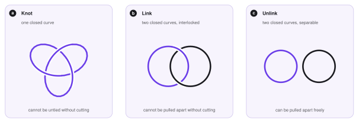
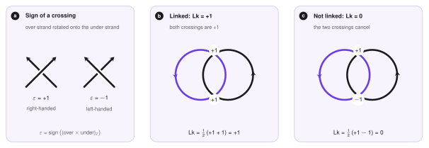
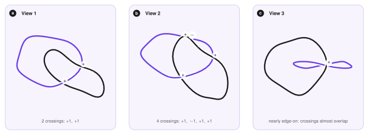
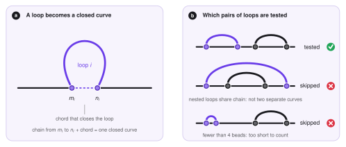
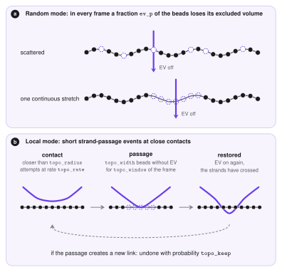

# Topology

This page explains the *topological* side of LoopSage: whether the loops of a 3D structure are interlocked, how this is measured, and which optional switches model it.
It is an advanced, optional feature. Nothing here runs by default and the default model is unchanged.

## Why look at topology?

A chromatin fibre is a very long thread. In the nucleus a thread cannot pass through another thread (the two strands repel each other), unless an enzyme, a *topoisomerase*, cuts one strand, passes the other one through and joins the cut again.
Because of this rule, the way two pieces of the fibre are wound around each other is not changed by the usual motion of the chain. It is a *conserved* property, called its *topology*.

In loop extrusion this matters in a concrete way. Each ring holds a *loop*, and loops of different rings sit close to each other in space. Two loops can lie next to each other like two separate rubber bands, or they can pass through each other like two links of a chain. The second case is called *catenation*, and it can only be created or removed by strand passage.

## Knots and links

Topology studies shapes that can be deformed without cutting or gluing (a deformation without cutting is called an *isotopy*). Two objects are *the same* if one can be deformed into the other in this way. A coffee cup and a doughnut are the same in this sense, a doughnut and a sphere are not.

For closed threads there are two basic objects.

- A *knot* is *one* closed curve in 3D space. The simplest closed curve is a round circle, the *unknot*. A knot is a closed curve that cannot be deformed into a circle without cutting it. The simplest one is the *trefoil*.
- A *link* is a set of *two or more* disjoint closed curves, called its *components*. The simplest link is the *Hopf link*: two circles, each passing through the other. The *unlink* is the trivial case, curves that can be pulled apart.

<figure markdown>
  { width="760" }
  <figcaption markdown="span">A knot is one closed curve (here the trefoil), a link is several closed curves (here the Hopf link), and in the unlink the curves can be separated. At every crossing the strand that is cut by a gap passes *under* the other one.</figcaption>
</figure>

### In which dimensions do they exist?

A closed curve is a one-dimensional object. Knots and links need room to *go around* each other, and the number of dimensions of the space decides how much room there is.

| Space | What happens |
|---|---|
| a line (1D) | a closed curve does not even fit |
| the plane (2D) | no knots and no links. Every simple closed curve (one that does not cross itself) is equivalent to a circle (the *Jordan curve theorem*), and two disjoint circles are either one inside the other or side by side, never interlocked |
| ordinary space (3D) | knots and links exist, and there are infinitely many different ones |
| 4D and higher | no knots and no links: there is a free direction, so any closed curve can be unknotted and any two curves can be pulled apart |

Knots and links are therefore a purely three-dimensional phenomenon. This is why topology cannot be read from the contact map or from the loop list alone, and why LoopSage needs the *3D structures* (the molecular dynamics stage) to study it.

## Knots or links?

For the loops of LoopSage the natural object is a *link*, for four reasons.

1. **The fibre is not closed.** A chromosome piece is an open chain with two free ends, and strictly speaking an open chain cannot be knotted, because a knot needs a closed curve.
2. **Loops are closed curves.** The two legs of a ring, $m_i$ and $n_i$, are held together by the ring, so they are neighbours in space. The stretch of fibre between them, closed by this short gap, is a closed curve (see below).
3. **The question is about pairs.** Loops are short and rarely knot on their own. The biologically interesting question is whether two *different* loops are interlocked, that is, whether the set of loops forms a link.
4. **The ring itself is a link.** A cohesin ring that holds DNA inside it is thought to be topologically linked with it (the ring entraps the fibre).

The tools that analyse *knots* of a single chain, such as the Python package *Topoly* (Dabrowski-Tumanski et al. 2021), compute polynomial invariants (Alexander, Jones, HOMFLY-PT) of a closed curve. They are the right tool to ask whether a protein or a closed DNA ring is knotted, and they can also compute linking numbers. LoopSage needs one quantity for many pairs of loops in thousands of frames, so it uses its own small implementation of the *linking number*, defined next. It does not depend on any external topology package.

## The linking number

The *linking number* $\mathrm{Lk}$ is the simplest and most useful number that tells how two closed curves are interlocked.
It is defined for two *oriented* curves (we choose a direction along each curve). Draw the pair on a plane, so that at every crossing one strand is over and the other is under. A crossing between the two curves gets a sign $\varepsilon=\pm1$:

- $\varepsilon=+1$ (*right-handed*) if the over strand has to be rotated counter-clockwise (by less than half a turn) to point along the under strand,
- $\varepsilon=-1$ (*left-handed*) otherwise.

Then

$$
\mathrm{Lk}(\gamma_1,\gamma_2) \;=\; \frac12 \sum_{\text{crossings between } \gamma_1 \text{ and } \gamma_2} \varepsilon .
$$

Crossings of a curve with itself are not counted. Every crossing between the two curves is counted once, and half of the sum is used because, as in the Hopf link, the curves pass each other in pairs.

<figure markdown>
  { width="760" }
  <figcaption markdown="span"><b>a</b> The sign of a crossing. <b>b</b> The Hopf link has two crossings of sign +1, so Lk = +1. <b>c</b> Two circles that overlap in the picture but are not interlocked: the same curve is over at both crossings, the signs cancel and Lk = 0. Counting crossings alone would be misleading.</figcaption>
</figure>

The most important properties are the following.

- $\mathrm{Lk}$ is an *integer*, and it does not depend on how the curves are drawn: any deformation without cutting leaves it unchanged. It is an *invariant*.
- If $\mathrm{Lk}\neq0$ the curves are linked. The reverse is not true: there are linked curves with $\mathrm{Lk}=0$ (the Whitehead link), so $\mathrm{Lk}=0$ only says that the simplest test finds no linking.
- When a strand of one curve is passed through the other curve (what a topoisomerase does), $\mathrm{Lk}$ changes by exactly $\pm1$.
- Reversing the direction of one curve changes the sign of $\mathrm{Lk}$. We therefore report $|\mathrm{Lk}|$ and call a pair *linked* if $|\mathrm{Lk}|\ge 1$.

### The same number as an integral

The linking number can also be written without any drawing. Let $\mathbf r_1(s)$ and $\mathbf r_2(t)$ be points of the two curves. Then

$$
\mathrm{Lk}(\gamma_1,\gamma_2) \;=\; \frac{1}{4\pi}\oint_{\gamma_1}\oint_{\gamma_2}
\frac{(\mathbf r_1-\mathbf r_2)\cdot(\mathrm d\mathbf r_1\times \mathrm d\mathbf r_2)}{\lVert \mathbf r_1-\mathbf r_2\rVert^{3}} .
$$

This is the *Gauss integral* (Gauss, 1833). Its meaning is geometric. The unit vector $(\mathbf r_1-\mathbf r_2)/\lVert\mathbf r_1-\mathbf r_2\rVert$ that points from one curve to the other changes as the two points move along their curves, and it covers the sphere of directions a whole number of times. The factor $1/4\pi$ is the inverse of the area of the unit sphere, so $\mathrm{Lk}$ is exactly *how many times* the sphere is covered.

## Why is it hard to compute in 3D?

The drawing recipe needs a *projection* of the 3D curves onto a plane. For a computer model, which is a chain of beads joined by straight segments, this causes several problems.

1. **The picture depends on the viewing direction.** From one direction the two loops cross twice, from another four times. Only the signed sum is the same.
2. **Some directions are bad.** If we look along a direction in which two segments overlap, or a bead lies exactly behind another segment, the crossing is degenerate, and the over/under decision is not defined. One has to find a "generic" direction, or average over many.
3. **Structures are noisy.** A molecular dynamics frame is a wiggling polymer with segments that pass very close to each other. A tiny change of the viewing direction can create or remove crossings.
4. **Closed curves are needed.** The loops of a chain are open pieces of the fibre.
5. **There are many pairs and many frames.** A region has tens of loops, so hundreds of pairs, in every analysed frame.

<figure markdown>
  { width="760" }
  <figcaption markdown="span">One pair of linked loops, taken from a 3D polymer, seen from three directions. The number of crossings changes (2, 4, and an almost edge-on view in which the crossings pile up), but half the sum of the signs is always +1, which was also computed with the Gauss integral. The pictures are generated from the actual 3D coordinates.</figcaption>
</figure>

### What LoopSage does

LoopSage avoids projections completely and computes the Gauss integral directly on the 3D coordinates.

1. **Closing the loops.** Every loop is the piece of the chain between the two legs of a ring, beads $m_i,\dots,n_i$. The closing segment between the two anchors (the *chord*) turns it into a closed polygon. This is a good approximation because the ring holds the two anchors next to each other.
2. **Which pairs are tested.** Only pairs of loops that are really two separate curves are tested. Nested or overlapping loops share a piece of the chain, so they are not two separate curves and are skipped, and a loop of fewer than 4 beads is too short to be counted as a curve. What remains are loops that lie side by side along the chain, which can still be interlocked in 3D.
3. **Exact formula for polygons.** For two closed polygons the double integral is a *finite sum over pairs of segments*, one term for every segment of the first loop and every segment of the second (Klenin and Langowski 2000). Each term is the signed area on the unit sphere swept by the direction between the two segments, written with the four unit vectors that join their end points. The sum divided by $4\pi$ is an integer up to rounding errors, and LoopSage rounds it to give $\mathrm{Lk}$. It is exact for the polygon, needs no projection and has no degenerate directions.
4. **A cheap pre-filter.** Two curves whose bounding boxes do not overlap cannot be linked, so the sum is only computed for pairs whose boxes overlap.

<figure markdown>
  { width="760" }
  <figcaption markdown="span"><b>a</b> A loop becomes a closed curve when its two anchors are joined by a chord. <b>b</b> Only pairs of loops that are separate curves are tested. Nested or overlapping loops and loops shorter than 4 beads are skipped.</figcaption>
</figure>

## Linking in LoopSage

!!! note "In LoopSage"
    The linking analysis is switched on with `--knots` (key `detect_knots`) and works on the 3D structures, so it needs the molecular dynamics stage (`run_MD = True`).
    The name *knots* is historical: the quantity that is computed is the *linking number* of pairs of loops, as explained above.

For every `knots_stride`-th MD frame LoopSage takes the loops $(m_i,n_i)$ of the Monte Carlo configuration that belongs to that frame, closes them, tests all admissible pairs and stores the pairs with $|\mathrm{Lk}|\ge1$. From this it reports:

- the number of linked pairs per frame, next to the number of pairs that were tested,
- the *lifetime* of a link, which is the number of consecutive analysed frames in which the same pair stays linked, and how many links are formed and dissolved at each step,
- the closest approach of two loops, and a *link map*, which shows where along the chromosome linked pairs occur,
- 3D snapshots of linked examples, in which the two loops are thick, closed by their chords, and a gold marker shows where they meet.

### Why links appear and disappear

If the excluded volume were perfect, strands could never cross, and the topology of the chain could not change during the molecular dynamics. Links would then only come and go because the *loops themselves* change, since the Monte Carlo trajectory moves the legs and the pair of loops that is analysed is not the same in every frame. The second source is the topoisomerase.

### The topoisomerase and the crossing counter

LoopSage offers two optional models of a topoisomerase II, both set in the `[topology]` section and both off by default.

- **`random` mode** (`ev_p`, `continuous_top`). In every frame a random fraction `ev_p` of the beads has its excluded volume switched off, either scattered or as one continuous stretch (`continuous_top`). Strands can pass through these beads.
- **`local` mode** (`topo_mode = local`). Short strand-passage events: at close contacts, a strand of `topo_width` beads loses its excluded volume for a short window `topo_window` of the frame, and then the volume is switched on again. The attempts occur at a rate `topo_rate` per frame and per 1000 beads, between strands closer than `topo_radius` bond lengths. With `topo_keep < 1` a passage that *creates* a new link is undone with probability $1-$`topo_keep`, which models a topoisomerase that simplifies the topology.

<figure markdown>
  { width="700" }
  <figcaption markdown="span"><b>a</b> Random mode: in every frame some beads have no excluded volume (dashed), scattered or in one stretch, and a strand can pass through them. <b>b</b> Local mode: two strands come close, a short stretch of one loses its excluded volume for a short window, the other strand passes through, and the volume is restored. A passage that creates a new link can be undone.</figcaption>
</figure>

The *crossing counter* (`track_crossings`, checked every `track_every` MD steps) detects two bonds that pass through each other between two checks. Crossings that occur with the excluded volume on are *leaks* of the force field, and crossings through a switched-off bead are *passages*.

How easily strands cross is controlled by the excluded volume $E(r)=\big(\varepsilon^2 s/(r+r_0)\big)^{p}$, where $s$ is the strength (`ev_ff_strength`), $p$ the exponent (`ev_ff_power`), $r$ the distance between two beads and $r_0$ a small softening length.
Two bonds can only cross if four bead pairs overlap, so the *barrier* for a crossing is the lowest value of the sum of $E$ over these four pairs, in units of $k_BT$. A barrier of a few $k_BT$ is crossed easily, and about $10\,k_BT$ or more keeps the chain intact. The topology report prints the barrier of the current setting, and `ev_barrier_target` is the barrier for which it suggests a new `ev_ff_strength`.

### Keys

| Key | Meaning |
|---|---|
| `detect_knots` (`--knots`) | linking analysis of the loops in 3D |
| `knots_stride` | analyse every n-th MD frame |
| `topo_mode` | `random` (default) or `local` topoisomerase model |
| `ev_p`, `continuous_top` | `random` mode: share of beads without excluded volume, and whether they form one stretch |
| `topo_rate`, `topo_radius`, `topo_width`, `topo_window` | `local` mode: rate, reach, strand length and duration of the passage events |
| `topo_keep` | `local` mode: probability to keep a passage that creates a link (1 = no bias) |
| `track_crossings`, `track_every` | count chain crossings, and how often to check |
| `ev_barrier_target` | barrier (in $k_BT$) used to suggest `ev_ff_strength` |

All keys are described in the [config reference](../reference/config.md), and `examples/11_topology_links.ini` is a ready example.

## References

- Gauss C. F. (1833). Integral formula for linking number. *Werke* 5, 605.
- Klenin K., Langowski J. (2000). Computation of writhe in modeling of supercoiled DNA. *Biopolymers* 54, 307.
- Dabrowski-Tumanski P., Rubach P., Niemyska W., Gren B. A., Sulkowska J. I. (2021). Topoly: Python package to analyze topology of polymers. *Briefings in Bioinformatics* 22, bbaa196.
- Rolfsen D. (1976). *Knots and Links*. Publish or Perish.
